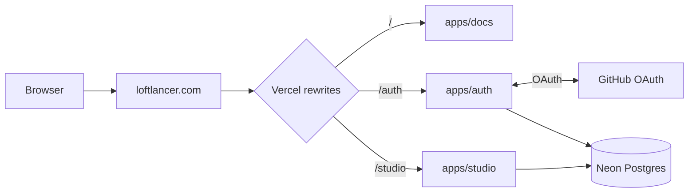

<p align="center"></p>

# Loftlancer

**Loftlancer** is an environment and secrets manager for teams. Store and organize environment variables across **organizations**, **projects** and **environments** (dev, staging, production), with values encrypted at rest, role-based access, an audit timeline, notifications and soft deletes.

**Live:** [loftlancer.com](https://loftlancer.com) · [Sign in](https://loftlancer.com/auth/sign-in) · [Studio](https://loftlancer.com/studio)

## Architecture

Loftlancer runs as **one Vercel project** (Vercel Services) on **loftlancer.com**, with three Next.js apps routed by path:

| Path | App | Purpose |
| ---- | --- | ------- |
| `/` | `apps/docs` | Landing page and Fumadocs documentation (static export) |
| `/auth` | `apps/auth` | Sign-in (GitHub, Google when configured, email magic links; no passwords), sessions and account settings (`/auth/settings/*`) |
| `/studio` | `apps/studio` | Product dashboard: organizations, projects, environments, variables |

Routing lives in the root [`vercel.json`](./vercel.json) (`services` + `rewrites`). Session cookies are same-origin on loftlancer.com. Better Auth is served at `/auth/api/auth`; the GitHub OAuth callback is `https://loftlancer.com/auth/api/auth/callback/github`.



## Workflow & contributions

- Track work in [GitHub issues](https://github.com/jayantrohila57/loftlancer/issues). Every commit references its issue with **`Fixes #N`**.
- Delivery: feature branch → `dev` → `main`. Only `main` deploys (one Vercel production deploy per push). See [AGENTS.md](./AGENTS.md).

## Monorepo layout

| Path | Purpose |
| ---- | ------- |
| `apps/docs` | Landing + docs at `/` |
| `apps/auth` | Auth issuer + account settings at `/auth` |
| `apps/studio` | Product UI at `/studio` |
| `packages/api` | tRPC routers (projects, orgs, access, audit, notifications, account, …) |
| `packages/actions` | Canonical action registry, org roles, `requireAction` evaluation |
| `packages/auth` | Better Auth (GitHub OAuth, organizations, teams) |
| `packages/auth-client` | Shared Better Auth React client |
| `packages/db` | Drizzle schema, migrations, soft-delete helpers, `db:reset-seed` |
| `packages/notifications` | Notification types, triggers, idempotent writers |
| `packages/crypto` | AES-256-GCM encrypt/decrypt for secret values |
| `packages/env` | Shared Zod env validation & feature flags |
| `packages/mcp` | MCP tool definitions (used by the docs tool reference) |
| `packages/config` | Shared TypeScript/Biome config |
| `packages/ui` | Shared coss/shadcn UI (`@loftlancer/ui`) |

**Legacy history:** `apps/web`, `apps/www`, `apps/console`, `apps/mcp`, `apps/account` and `apps/support` were removed in October 2026 ([#163](https://github.com/jayantrohila57/loftlancer/issues/163)). Account settings moved into `apps/auth`; the admin console, standalone MCP server and support app are no longer deployed. Their history remains in git.

## Product concepts

| Area | Behavior |
| ---- | -------- |
| **Roles** | Org **Owner**, **Manager**, **Member** (legacy `admin` → Manager). Platform **Admin** reserved for future console. |
| **Teams** | Better Auth teams under each organization |
| **Project access** | Per-project manager rows, team links, and member **CRUD grants** |
| **Actions** | `@loftlancer/actions` names every gated operation; server uses `requireAction` |
| **Audit** | `audit_event` + Timeline UIs when `ACTIONS_AUDIT_ENABLED=true` |
| **Soft delete** | `deleted_at` / `deleted_by` when `SOFT_DELETES_ENABLED=true` |
| **Organizations** | `/dashboard/organizations` hub (members, teams, invitations, roles, settings, timeline) |
| **Account settings** | `/dashboard/settings/*` — profile, sessions, accounts, export, delete, personal timeline |

Deep specs: [docs/ACTIONS_PERMISSIONS_AUDIT.md](./docs/ACTIONS_PERMISSIONS_AUDIT.md), [docs/SOFT_DELETES.md](./docs/SOFT_DELETES.md), [UI.md](./UI.md), [docs/DESIGN_SYSTEM.md](./docs/DESIGN_SYSTEM.md).

## Prerequisites

- **Node.js** 22.14+ (`engines` in root `package.json`)
- **pnpm** [12.11.2](https://pnpm.io/) — `packageManager` in root `package.json`; use [Corepack](https://nodejs.org/api/corepack.html)
- **PostgreSQL** — `DATABASE_URL` (e.g. [Neon](https://neon.tech))
- **GitHub OAuth app** — `GITHUB_CLIENT_ID` / `GITHUB_CLIENT_SECRET`

## Install

```bash
git clone https://github.com/jayantrohila57/loftlancer.git
cd loftlancer
corepack enable
corepack prepare pnpm@12.11.2 --activate
pnpm install
```

## Environment variables

Create **`apps/studio/.env`** (Drizzle Kit reads this path for database commands). Validated via `@loftlancer/env`:

| Variable | Required | Description |
| -------- | -------- | ----------- |
| `DATABASE_URL` | yes | PostgreSQL connection URL |
| `BETTER_AUTH_SECRET` | yes | Session secret (≥ 32 characters) |
| `BETTER_AUTH_URL` | yes | Public auth app URL (`https://loftlancer.com/auth` in production, `http://localhost:3000` locally) |
| `CORS_ORIGIN` | yes | Browser origin (usually same as `BETTER_AUTH_URL` in dev) |
| `ENCRYPTION_KEY` | yes | 64 hex chars (32 bytes) for AES-256-GCM |
| `GITHUB_CLIENT_ID` / `GITHUB_CLIENT_SECRET` | yes | GitHub OAuth |
| `ORGANIZATIONS_ENABLED` | no | `true` to scope projects to active org |
| `NOTIFICATIONS_ENABLED` | no | In-app notifications |
| `VARIABLES_V2_ENABLED` | no | Typed variables (`secret` / `config`) |
| `ACTIONS_AUDIT_ENABLED` | no | `audit_event` + timeline routes |
| `SOFT_DELETES_ENABLED` | no | Soft delete semantics |
| `NEXT_PUBLIC_*` | no | Client mirrors for flags above (rebuild after change) |
| `NODE_ENV` | no | `development` \| `production` \| `test` |
| `SKIP_ENV_VALIDATION` | no | `1` skips Zod (not recommended) |

Example secret generation:

```bash
openssl rand -hex 32    # ENCRYPTION_KEY
openssl rand -base64 32 # BETTER_AUTH_SECRET
```

GitHub OAuth callback: `{BETTER_AUTH_URL}/api/auth/callback/github` (production: `https://loftlancer.com/auth/api/auth/callback/github`).

## Database

Local sync:

```bash
pnpm db:push
```

| Script | Purpose |
| ------ | ------- |
| `pnpm db:migrate` | Drizzle migrate (journal-based workflows) |
| `pnpm db:generate` | Generate migration SQL |
| `pnpm db:studio` | Drizzle Studio |
| `pnpm db:reset-seed` | **Destructive** wipe + sample seed — [docs/DB_RESET.md](./docs/DB_RESET.md) |

Production uses **reviewed SQL / push**, not automatic migrate on deploy — [packages/db/DATABASE.md](./packages/db/DATABASE.md). Major platform cut: [docs/PLATFORM_MIGRATION_COMBINED.md](./docs/PLATFORM_MIGRATION_COMBINED.md) (Neon backup → migrate → flags → optional reset-seed with owner retention).

## Run & build

```bash
pnpm dev:auth     # http://localhost:3000
pnpm dev:studio   # http://localhost:3001
pnpm dev:docs
pnpm dev          # all apps via Turbo
pnpm build
pnpm check-types
pnpm test
```

Optional Postgres integration tests (for example `packages/api` `*.integration.test.ts`) are skipped by default. Opt in with `TEST_DATABASE_URL` (connection string used for those tests only; `DATABASE_URL` is ignored) or `RUN_DB_INTEGRATION_TESTS=1` (still requires `TEST_DATABASE_URL`).

## Tech stack

- **App:** Next.js, React, TypeScript, Tailwind, **coss ui** (Base UI) via shadcn registry
- **API:** tRPC, TanStack Query
- **Auth:** Better Auth (GitHub, Google, magic links; organizations, teams)
- **Database:** PostgreSQL, Drizzle ORM
- **Tooling:** pnpm workspaces, Turborepo, Biome
- **Deploy:** Vercel — production from **`main`** only ([loftlancer.com/studio](https://loftlancer.com/studio))

## Documentation index

| Doc | Topic |
| --- | ----- |
| [AGENTS.md](./AGENTS.md) | Issues, git, agent rules |
| [UI.md](./UI.md) | Domain architecture & page patterns |
| [docs/DESIGN_SYSTEM.md](./docs/DESIGN_SYSTEM.md) | coss ui, spacing tokens, components |
| [docs/DB_RESET.md](./docs/DB_RESET.md) | Reset-seed policy |
| [docs/PLAN_PLATFORM_APPS.md](./docs/PLAN_PLATFORM_APPS.md) | Multi-app + SSO decision §14 |
| [docs/PLAN_MCP_AND_CONSOLE.md](./docs/PLAN_MCP_AND_CONSOLE.md) | MCP & console research |
| [docs/PRODUCTION_DEPLOY.md](./docs/PRODUCTION_DEPLOY.md) | Production deploy checklist & Vercel limits |
| [SECURITY.md](./SECURITY.md) | Vulnerability reporting |

## Security

See [SECURITY.md](./SECURITY.md).

## Brand


**Organizations, projects, environments and encrypted variables for your team and your agents.**

Brand assets live in [`.github/brand`](.github/brand): logo mark (SVG and PNG), wordmark (SVG), light and dark lockups, app icons (512, 192 and 32 px), an Open Graph image (1200×630), a GitHub social preview (1280×640), this README banner, an X/LinkedIn banner (1500×500) and a palette sheet.

| Role | Hex | Source |
| --- | --- | --- |
| Primary (light) | `#262626` | `--primary = neutral-800` |
| Primary foreground | `#fafafa` | `--primary-foreground = neutral-50` |
| Background (light) | `#ffffff` | `--background = white` |
| Background (dark) | `#161616` | `--background (dark) = neutral-950 95% + white` |
| Foreground (dark) | `#f5f5f5` | `--foreground (dark) = neutral-100` |

Type: Inter (UI) and Geist Mono (code), from `packages/ui/src/lib/fonts.ts`.

## Sponsor

If you find this project useful, consider supporting its development:

[](https://github.com/sponsors/jayantrohila57)

## License

Released under the [MIT License](LICENSE).
