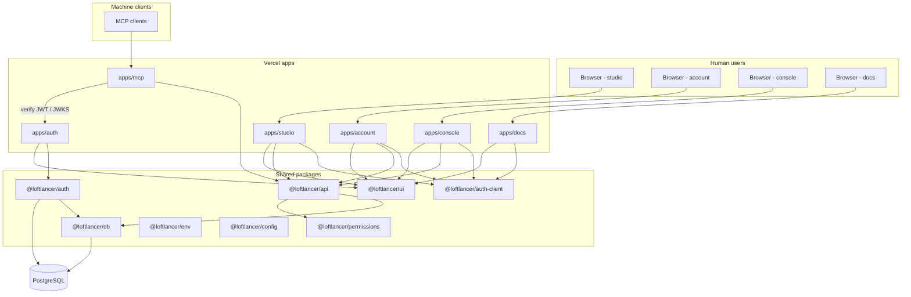
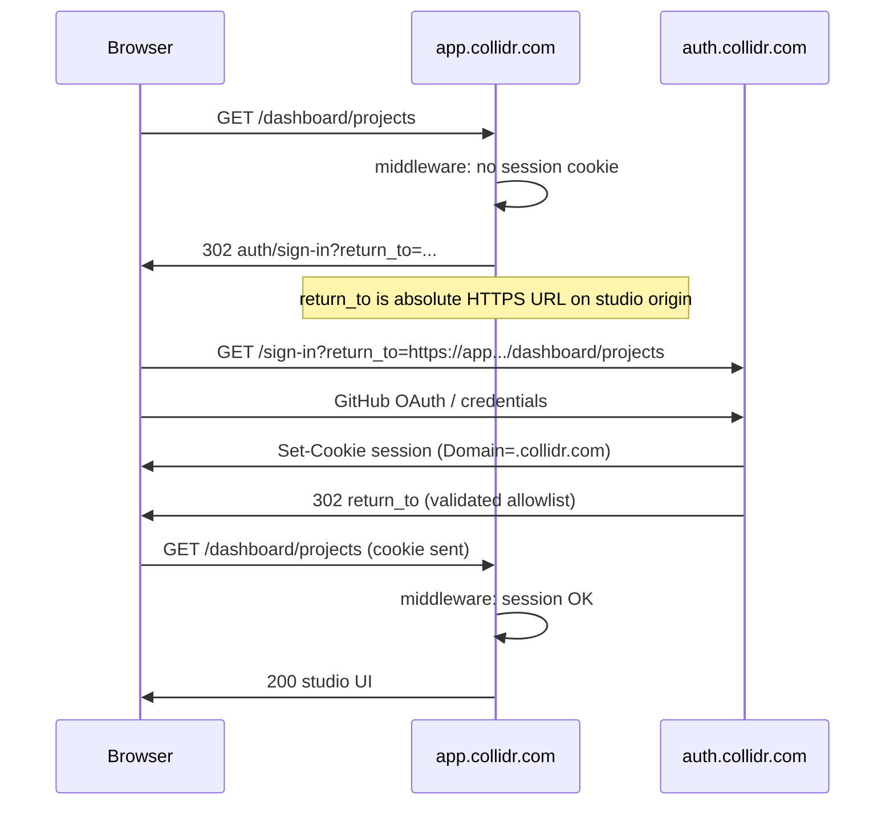
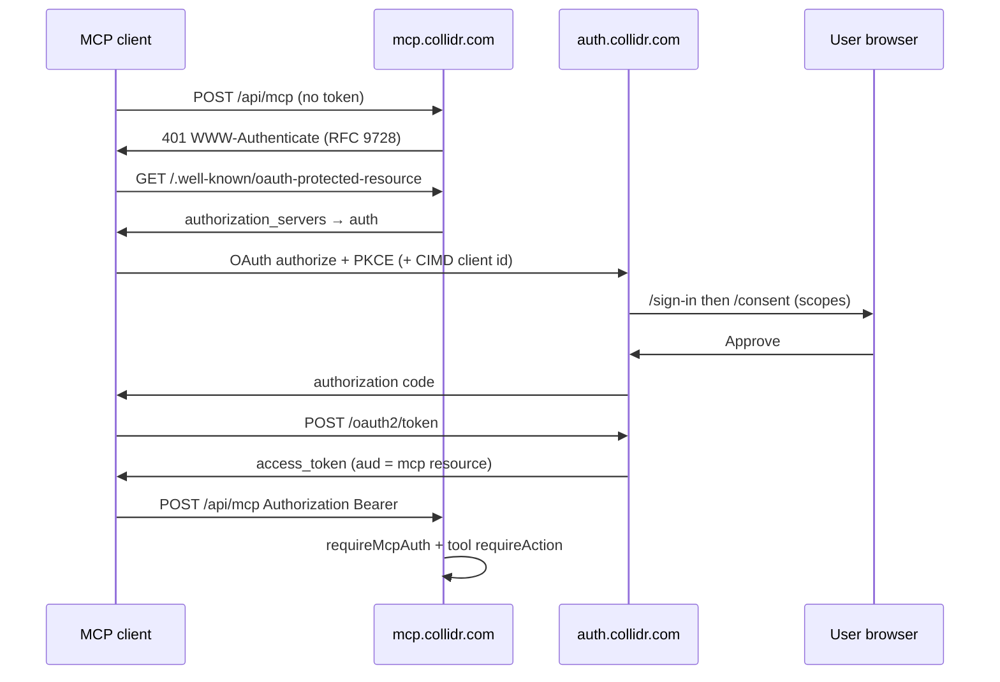

# Plan: Platform apps (auth, account, studio, console, mcp, docs)

**Status:** **Implementation** — §14 decisions **resolved** (20/20); work tracked via `[Platform]` GitHub issues (§12).  
**Supersedes:** [`docs/PLAN_MCP_AND_CONSOLE.md`](./PLAN_MCP_AND_CONSOLE.md) (MCP + console scope is folded in here).  
**Baseline:** Monorepo today with product app **`apps/web`** (orgs/projects/envs/variables, account settings under `/dashboard/settings`, sign-in at `/sign-in`, auth at `/api/auth/*` on the same host).  
**Related:** [`docs/ACTIONS_PERMISSIONS_AUDIT.md`](./ACTIONS_PERMISSIONS_AUDIT.md), [`docs/DESIGN_SYSTEM.md`](./DESIGN_SYSTEM.md), [`AGENTS.md`](../AGENTS.md) (issue workflow, **main-only** deploy).

---

## 1. Target app map

| App | Purpose | UI | Auth surface |
|-----|---------|-----|--------------|
| **`apps/auth`** | Single entry for **sign-in / sign-up / sign-out** for all products; **OAuth 2.1 authorization server**; **MCP authorization** (login + consent for MCP clients). Hosts Better Auth route handler only (+ minimal auth/consent/device pages). | coss ui (minimal) | **Issuer** — `BETTER_AUTH_URL` = auth origin |
| **`apps/account`** | **Account management** moved out of studio: profile, sessions, connected accounts, export, delete, personal audit timeline. | coss ui | Session cookie (SSO) |
| **`apps/studio`** | **Main product** — rename/migrate from `apps/web`: orgs, projects, environments, variables, org hub, notifications, onboarding. **No** account settings (link out to account). | coss ui | Session cookie (SSO) |
| **`apps/console`** | **Platform admin** (`user.role = admin` + Better Auth admin plugin): users, orgs, projects, sessions, global audit, impersonation/ban, MCP OAuth clients/tokens, feature flags, health. | coss ui | Session cookie (SSO) + **Admin role** + **email allowlist** (Decision 11) |
| **`apps/mcp`** | **API-only** remote MCP server (stateless HTTP `POST`, MCP 2026-07-28). | none | OAuth access token (+ optional DPoP) |
| **`apps/docs`** | Product + MCP documentation (**Fumadocs** + built-in search, Decision 9) with **our** chrome (`@loftlancer/ui`). **Fully public** (Decision 10). | coss ui shell + Fumadocs primitives | Public read; optional “edit on GitHub”; optional sign-in link to studio |
| **`apps/www`** | **Marketing landing** at apex / `www` (Decision 4) — product positioning, CTAs to auth/studio; not the signed-in app. | coss ui | Public; links to auth `sign-in` with `return_to` |

**Invariant:** One Postgres database, one `@loftlancer/auth` server config instantiated **only** on `apps/auth` (other apps use `@loftlancer/auth-client` + session validation / tRPC context).

---

## 2. Domains and subdomains (production)

Each app = **one Vercel project** with its own root directory. Production deploys from **`main` only** (no branch previews).

### 2.0 Phase 1 — `*.vercel.app` subdomains (Decision 1, §14)

Until custom DNS is approved, **every app** is deployed on its own hostname under **`vercel.app`**, using a **fixed naming pattern** (one Vercel project per app):

**Pattern:** `https://<app>-collidr.vercel.app`

| App | Planned production hostname | `BETTER_AUTH_URL` (auth app only) |
|-----|-----------------------------|-----------------------------------|
| **`apps/auth`** | `https://loftlancer.com/auth` | **self** |
| **`apps/studio`** | `https://loftlancer.com/studio` | `https://loftlancer.com/auth` |
| **`apps/account`** | `https://loftlancer.com/account` | `https://loftlancer.com/auth` |
| **`apps/console`** | `https://loftlancer.com/console` | `https://loftlancer.com/auth` |
| **`apps/mcp`** | `https://loftlancer.com` | issuer/JWKS → auth |
| **`apps/docs`** | `https://loftlancer.com/docs` | auth URL (nav only) |
| **`apps/www`** | `https://loftlancer.com` | links to auth |

**Legacy (today):** `https://loftlancer.com/studio` (`apps/web`) → at P3 cutover, alias or redirect to **`studio-collidr.vercel.app`** (§8.3).

**GitHub OAuth callback (phase 1):** `https://loftlancer.com/auth/api/auth/callback/github` after auth app cutover.

#### Public Suffix List (why cookies cannot span apps)

`vercel.app` is on the [Public Suffix List](https://publicsuffix.org/) (PSL). Browsers treat each `*-collidr.vercel.app` host as a **separate site** for cookies — you **cannot** set `Domain=.vercel.app` or share a session cookie across `auth-collidr` and `studio-collidr`. **`crossSubDomainCookies` does not work on `vercel.app`** (Decision 1).

#### SSO on `vercel.app` (redirect / OIDC)

- Relying parties redirect to **`apps/auth`** for sign-in (authorization code + PKCE).
- After auth, user returns to the target app with a **session cookie scoped to that hostname only**.
- **First visit to each app** in a session: expect a **short auth-app round-trip** (OIDC **silent re-auth** / `prompt=none` when the user already has an auth-app session) to mint the **per-app** cookie without showing login again when possible.
- This is normal on PSL hostnames; it is **not** “broken SSO.”

#### Custom apex later — config-only (Decision 2)

Implement URLs and cookie policy so **P4** is **configuration**, not a rewrite of app code:

| Concern | Phase 1 (`vercel.app`) | After P4 (custom apex) |
|---------|------------------------|-------------------------|
| Public URLs | `@loftlancer/env` — `BETTER_AUTH_URL`, `NEXT_PUBLIC_*_URL` per app (§2.1 hostnames) | Same env keys; swap values to `https://auth.collidr.com`, etc. |
| `trustedOrigins` / `allowedReturnOrigins` | Explicit list of §2.0 hostnames (Decision 12) | Replace list with §2.1 production origins |
| Session cookies | Per-app origin only; **no** `crossSubDomainCookies` | Optionally enable `crossSubDomainCookies` with `domain: ".collidr.com"` (Decision 2) after security review |
| SSO UX | Redirect + silent re-auth per app | May reduce round-trips if shared cookie enabled |

No separate “vercel mode” vs “apex mode” code paths in product routers — only env + Better Auth `advanced.crossSubDomainCookies` toggles.

### 2.1 Future — custom apex (deferred)

Example apex: **`collidr.com`**.

| App | Subdomain | Public role |
|-----|-----------|-------------|
| auth | `https://auth.collidr.com` | Login, OAuth `/oauth2/*`, well-known |
| account | `https://account.collidr.com` | Account settings |
| studio | `https://app.collidr.com` | Product |
| console | `https://console.collidr.com` | Platform admin |
| mcp | `https://mcp.collidr.com` | MCP `POST /api/mcp` |
| docs | `https://docs.collidr.com` | Documentation |
| www | `https://collidr.com` / `https://www.collidr.com` | Marketing (Decision 4) |

**Marketing / www:** served by **`apps/www`** (Decision 4), not studio or docs.

**GitHub OAuth callback (apex):** `https://auth.collidr.com/api/auth/callback/github` (single callback after cutover).

### 2.2 Local development

| App | Port | Host hint |
|-----|------|-----------|
| auth | 3000 | `auth.localhost` or `localhost:3000` |
| studio | 3001 | `app.localhost` |
| account | 3002 | `account.localhost` |
| console | 3003 | `console.localhost` |
| mcp | 3004 | `mcp.localhost` |
| docs | 3005 | `docs.localhost` |
| www | 3006 | `www.localhost` |

Cross-port cookie SSO is unreliable; prefer **shared parent** `*.localhost` + `crossSubDomainCookies` or auth proxy rewrites per app (see §5).

---

## 3. Architecture



---

## 4. Better Auth — official building blocks (cited)

Implement **`apps/auth`** strictly from Better Auth **≥ 1.7.x** docs (**Decision 20** — upgrade merged on `main` before any `apps/auth` scaffold).

| Concern | Doc | Usage on `apps/auth` |
|---------|-----|----------------------|
| Core server + database | [Database](https://www.better-auth.com/docs/concepts/database) | Drizzle adapter, shared schema |
| Sessions + cookies | [Sessions](https://www.better-auth.com/docs/concepts/session-management), [Cookies](https://www.better-auth.com/docs/concepts/cookies) | `crossSubDomainCookies`, `trustedOrigins` |
| Browser client | [Client](https://www.better-auth.com/docs/concepts/client) | Re-exported from `@loftlancer/auth-client` |
| OAuth for MCP | [MCP plugin](https://www.better-auth.com/docs/plugins/mcp) | `mcp({ loginPage, consentPage, resource })` — **is** the OAuth 2.1 provider; do **not** add separate `oauthProvider()` |
| OAuth 2.1 details | [OAuth 2.1 Provider](https://www.better-auth.com/docs/plugins/oauth-provider) | Schema: `oauthClient`, tokens, consent |
| MCP client identity | [CIMD](https://www.better-auth.com/docs/plugins/cimd), [MCP DCR](https://www.better-auth.com/docs/plugins/mcp#optional-dcr-fallback) | **Both** enabled (Decision 7): `cimd({ metadataProfile: "mcp-2026-07-28" })` + dynamic client registration where clients support it |
| JWT / JWKS | [JWT plugin](https://www.better-auth.com/docs/plugins/jwt) | Required for MCP/OAuth tokens |
| Orgs (product) | [Organization](https://www.better-auth.com/docs/plugins/organization) | Keep on shared auth config (studio uses org APIs via session) |
| Platform admin | [Admin](https://www.better-auth.com/docs/plugins/admin) | Console only consumers; enabled on same auth instance |
| Device authorization (auth v1) | [Device Authorization](https://www.better-auth.com/docs/plugins/device-authorization) | **Required** on `apps/auth` (Decision 8): `/device` for first-party CLI and headless flows |
| Enterprise SSO | [SSO plugin](https://www.better-auth.com/docs/plugins/sso) | **Deferred** (Decision 17) — post platform split / MCP; v1 auth = GitHub OAuth + device flow only |
| Legacy | Avoid deprecated in-repo `oidcProvider` / old `mcp` plugin — use **`@better-auth/mcp`** per [MCP plugin](https://www.better-auth.com/docs/plugins/mcp) |

**MCP resource URL:** phase 1 `mcp({ resource: "https://loftlancer.com/api/mcp" })`; apex `https://mcp.collidr.com/api/mcp` (§2.1). `apps/mcp` protects route with `requireMcpAuth` / `createMcpProtectedRequestHandler` ([MCP plugin — Protecting an MCP Route](https://www.better-auth.com/docs/plugins/mcp#protecting-an-mcp-route)).

**Vercel MCP hosting (Decision 15):** [`mcp-handler`](https://github.com/vercel-labs/mcp-handler) on `apps/mcp` per [Deploy MCP servers](https://vercel.com/docs/mcp/deploy-mcp-servers-to-vercel); auth via Better Auth **`requireMcpAuth`** / `createMcpProtectedRequestHandler` — not raw `@modelcontextprotocol/server` HTTP alone.

---

## 5. SSO: session sharing and return-to

**Phase 1 (§14 Decision 1, §2.0):** `vercel.app` is on the **PSL** — **no cross-subdomain cookies**. SSO is **auth-app redirect + OIDC** (authorization code + PKCE; **silent re-auth** on first hit to each sibling app when the user already has an auth session). Each app holds its **own** session cookie on its `*-collidr.vercel.app` origin. MCP uses **Bearer tokens** from auth, not browser cookies. **§5.1** (`crossSubDomainCookies`) applies only after **custom apex** (config flip per §2.0).

### 5.1 Future: shared parent domain + cross-subdomain cookies (custom apex only)

When all apps sit under one registrable apex (e.g. `*.collidr.com`), per [Cross Subdomain Cookies](https://www.better-auth.com/docs/concepts/cookies#cross-subdomain-cookies):

```ts
// packages/auth — used only by apps/auth
advanced: {
  crossSubDomainCookies: {
    enabled: true,
    domain: ".collidr.com", // Decision 2 — enable only at P4 via config
  },
},
trustedOrigins: [
  "https://auth.collidr.com",
  "https://app.collidr.com",
  "https://account.collidr.com",
  "https://console.collidr.com",
  "https://docs.collidr.com",
],
```

`trustedOrigins` lists **production hostnames only** (Decision 12) — no `*.vercel.app` preview wildcard, no branch preview URLs.

`BETTER_AUTH_URL` = `https://auth.collidr.com` (issuer + `/api/auth/*`).

**Sibling apps** do **not** mount `/api/auth/*`; they call `authClient` with `baseURL: process.env.NEXT_PUBLIC_AUTH_URL` and rely on the shared session cookie.

### 5.2 Safari / ITP fallback: per-app auth proxy

If auth and studio ever sit on **unrelated** domains, use [reverse proxy rewrites](https://www.better-auth.com/docs/concepts/cookies#using-a-reverse-proxy) so each app exposes **same-origin** `/api/auth/*` → `auth.collidr.com`.

```json
// apps/studio/vercel.json (example)
{
  "rewrites": [
    {
      "source": "/api/auth/:path*",
      "destination": "https://auth.collidr.com/api/auth/:path*"
    }
  ]
}
```

Prefer **one** strategy in prod: either all apps use rewrites **or** all use cross-subdomain cookies — mixing increases bug surface.

### 5.3 Browser SSO flow (studio → auth → studio)



### 5.4 Return-to / redirect contract

**Problem:** Today `apps/web` uses **relative** `redirect` query params (`safeRedirectPath` in `apps/web/src/lib/auth-routes.ts`). Multi-app SSO needs **cross-origin** return URLs.

**Proposed standard (all apps):**

| Param | Where | Rules |
|-------|-------|--------|
| `return_to` | Auth sign-in/sign-up/sign-out | **Required** for cross-app flows. Full `https://` URL. |
| Allowlist | `packages/auth` config | `allowedReturnOrigins`: production studio, account, console, docs origins only (Decision 12). |
| Validation | Auth app | Reject missing scheme, `javascript:`, non-allowlisted host; default fallback `https://app.collidr.com/dashboard`. |
| Relative paths | Deprecated | Map old `?redirect=/dashboard` on studio middleware → build absolute `return_to` pointing at studio. |

**Sign-out:** `auth/sign-out?return_to=https://docs.collidr.com` clears session cookie (domain-wide) then redirects.

**Account deep links from studio:** `https://account.collidr.com/settings/sessions` (no auth routes on account).

### 5.5 MCP OAuth flow (machine clients)



Login and consent pages live on **`apps/auth`** (`mcp({ loginPage: "/sign-in", consentPage: "/consent" })` per [MCP plugin](https://www.better-auth.com/docs/plugins/mcp#configure-authorization)).

### 5.6 Session validation on non-auth apps

Each app’s tRPC context / middleware:

1. `getSessionCookie` / `auth.api.getSession({ headers })` with `baseURL` = auth ([Client](https://www.better-auth.com/docs/concepts/client)).
2. No local Better Auth handler except optional **rewrite proxy**.
3. `activeOrganizationId` on session — studio org switcher updates via organization client plugin against auth API.

---

## 6. Per-app responsibilities

### 6.1 `apps/auth`

- Routes: `/api/auth/[...all]`, `/sign-in`, `/sign-up`, `/sign-out`, `/consent`, `/device` (**auth v1**, Decision 8).
- Plugins: `jwt()`, `mcp()` (CIMD + DCR per Decision 7), `cimd()`, `organization()`, `admin()` (when migration lands), **device authorization**, `nextCookies()`, social providers.
- **Does not** serve product or account settings UI beyond auth/consent.
- Env: `BETTER_AUTH_SECRET`, `BETTER_AUTH_URL`, `DATABASE_URL`, GitHub OAuth, `allowedReturnOrigins`, MCP `resource` URL.
- **Transactional emails (Decision 18):** verify / reset / invite links point at **auth** origin; after token handling, redirect onward to studio/account via allowlisted `return_to`.

### 6.2 `apps/account`

- Migrate from `apps/web/src/app/(private)/dashboard/settings/**` and domain `account` components.
- Routes: `/settings/profile`, `/settings/sessions`, `/settings/accounts`, `/settings/export`, `/settings/delete`, `/settings/timeline` (canonical actions: `profile.*`, `session.*`, `account.*`, `audit.timeline.view.self`).
- tRPC: `account` router (+ `auditEvents` self scope); **no** org/project routers.
- Middleware: session required; unauthenticated → auth with `return_to`.

### 6.3 `apps/studio` (from `apps/web`)

- Keep: `/dashboard/**` orgs, projects, envs, variables, notifications, onboarding.
- Remove: `/sign-in` (redirect to auth), `/dashboard/settings/*` (link to account app).
- Remove public marketing `(public)/(site)` — lives on **`apps/www`** (Decision 4, [#103](https://github.com/jayantrohila57/loftlancer/issues/103)).
- tRPC: full `appRouter` minus account-only procedures (or thin re-export).
- Middleware: same pattern as today (`apps/web/src/middleware.ts`) with auth URL for redirects.

### 6.4 `apps/console`

- Platform `platform.*` actions, admin plugin, MCP OAuth admin UI.
- Sign-in: auth with `return_to=console`; gate requires **platform Admin** (`isPlatformAdmin()`) **and** session user email ∈ **`CONSOLE_ALLOWED_EMAILS`** (Decision 11).
- **Env:** `CONSOLE_ALLOWED_EMAILS` — comma-separated emails allowed to use console in production (operator-set in Vercel; not committed). Initial production value: **`jrohila55@gmail.com`**. No **IP** allowlist or network restriction for console v1.
- Validate in `@loftlancer/env` when `apps/console` ships; non-allowlisted emails get **403** before console routes/tRPC even if they have Admin role elsewhere.

### 6.5 `apps/mcp`

- API-only; **transport:** Vercel [`mcp-handler`](https://github.com/vercel-labs/mcp-handler) adapter (Decision 15) exposing `POST /api/mcp` on Vercel.
- **Auth:** Better Auth MCP plugin — `requireMcpAuth` + tool handlers; issuer/JWKS from `apps/auth`; no session cookies.
- Tool inventory: see **Appendix A** (58 tools, scopes, canonical `requireAction`).
- **Rate limits:** token-bucket state in Postgres (`rate_limit_bucket` via `@loftlancer/db`) — Decision 14; no Vercel KV or Redis for MCP v1.

### 6.6 `apps/docs` (Fumadocs + our UI)

- **Content:** Fumadocs MDX (`fumadocs-mdx`, `fumadocs-core`) for docs structure, **built-in search** (Decision 9), sidebar tree.
- **Chrome:** `@loftlancer/ui` layout — app shell, header, footer, typography tokens from `apps/studio` / `DESIGN_SYSTEM.md`; **do not** ship Fumadocs default UI theme as-is.
- **Approach:** Fumadocs headless patterns + custom `docs/layout.tsx` wrapping coss `Sidebar`, `Breadcrumb`, `Button`; map Fumadocs `pageTree` to our nav components.
- Sections: product guides, API/tRPC overview, MCP tool reference (generated from registry), OAuth scopes, console (admin-only note).
- **Access:** **All documentation is public** — no gated or enterprise-only sections (Decision 10). Optional header link to product sign-in is cosmetic only.
- Deploy: `docs.collidr.com` (phase 1: `docs-collidr.vercel.app` per §2.0).

---

## 7. Shared packages

| Package | Status | Contents |
|---------|--------|----------|
| **`@loftlancer/config`** | exists | `tsconfig`, shared ESLint — extend per-app `next.config` helpers |
| **`@loftlancer/env`** | exists | Per-app Zod modules: `auth.ts`, `studio.ts`, `account.ts`, … + shared `server.ts` |
| **`@loftlancer/db`** | exists | Drizzle schema + migrations |
| **`@loftlancer/actions`** | exists | Canonical action registry |
| **`@loftlancer/permissions`** | **new** | `requireAction`, `actionGuard`, MCP scope maps (from `packages/api/src/actions`) |
| **`@loftlancer/auth`** | extend | `createAuth()` — **only imported by `apps/auth`** |
| **`@loftlancer/auth-client`** | **new** | `createAuthClient({ baseURL })`, React hooks, org client plugin |
| **`@loftlancer/api`** | extend | Shared `appRouter` / sub-routers + `services/*` for tRPC and MCP; each app mounts a **subset** at `/api/trpc` (Decision 16) |
| **`@loftlancer/ui`** | **new** | coss components, toast, icons, patterns (`PageHeader`, data-table) from `apps/web`; **impersonation banner** (Decision 19) |
| **`@loftlancer/docs-config`** | optional | Shared MDX components for docs + studio help links |

**Turbo:** `globalEnv` adds `NEXT_PUBLIC_AUTH_URL`, `NEXT_PUBLIC_STUDIO_URL`, etc.

### 7.1 tRPC deployment (Decision 16)

| Pattern | Detail |
|---------|--------|
| **Mount** | Each UI app (`studio`, `account`, `console`) exposes its own **`/api/trpc`** Next.js route. |
| **Router** | Import composed routers from **`@loftlancer/api`** — e.g. studio mounts full product router; account mounts `account` + self-scoped audit; console mounts operator procedures only. |
| **Excluded** | **No** dedicated `apps/gateway` or shared API-only Vercel project for tRPC in v1. |
| **MCP** | Same service layer as tRPC; MCP does not proxy through another app’s `/api/trpc`. |

---

## 8. Migration: `apps/web` → auth + account + studio

**Cutover style:** **Decision 5 (§14)** — one **big-bang** production switch. No beta hostname, no gradual traffic split, no dual-run of `apps/web` + studio in prod.

### 8.1 Principles

- **Single window:** `apps/auth`, `apps/account`, and `apps/studio` go live together; `apps/web` Vercel project is retired in the same change set.
- **SSO (phase 1):** Per **Decision 1** + **Decision 6**, auth-app redirects; existing `apps/web` sessions are **not** carried over — users **re-login once** at cutover (no dual-cookie window).
- **Database:** App split is routing/deploy only until MCP/console schema (`0008`); use a **Neon test branch** for full-stack verification before prod (see §8.2).
- **Prep in repo:** Feature freeze on `apps/web` while studio/account/auth reach parity; avoid long-lived production shims.

### 8.2 Pre-cutover verification (required)

Complete on a **Neon branch** (and matching Vercel **staging** hostnames or local multi-port setup) **before** touching production default.

| Area | Verification |
|------|----------------|
| **Schema** | Branch at or beyond required platform SQL; flags on (`ORGANIZATIONS_ENABLED`, `ACTIONS_AUDIT_ENABLED`, etc. as needed). |
| **Auth** | GitHub OAuth on auth hostname; `return_to` allowlist for studio + account origins. |
| **Studio** | E2E parity with current web: orgs, projects, envs, variables, notifications, onboarding, timelines. |
| **Account** | Profile, sessions, accounts, export, delete, personal timeline — no `/dashboard/settings` on studio. |
| **Cross-app** | Sign-in on auth → studio dashboard; studio links to account settings; sign-out returns to expected origin. |
| **Data** | Optional `pnpm db:reset-seed` on branch only ([DB_RESET.md](./DB_RESET.md)); owner `KEEP_USER_EMAIL` sign-in still works. |
| **Automated** | CI lint, route checks, typechecks, unit tests, and production build pass on the release commit. |

#### Pre-cutover checklist (prod gate)

- [ ] Neon **backup branch** from current production default created and named (e.g. `backup-before-app-split-YYYY-MM-DD`).
- [ ] All §8.2 verification rows signed off on Neon branch + staging URLs.
- [ ] GitHub OAuth app: **new callback URL** on auth hostname tested; old web callback removal planned for cutover instant.
- [ ] Vercel env: `BETTER_AUTH_URL`, `NEXT_PUBLIC_AUTH_URL`, studio/account URL graph, shared `BETTER_AUTH_SECRET` / `DATABASE_URL` aligned across three projects.
- [ ] Redirect map drafted: `collidr-web.vercel.app` → `studio-collidr.vercel.app`; `/dashboard/settings/*` → account paths.
- [ ] Owner comms: maintenance window + **one-time re-login** (Decision 6); no promise of seamless session continuity.
- [ ] Rollback owner identified; §8.4 steps reviewed.

### 8.3 Big-bang cutover (single maintenance window)

Execute in order during one coordinated change (no beta cohort).

| Step | Action |
|------|--------|
| **C1** | Freeze merges to `main` except cutover fixes; final `git pull --rebase` + green CI. |
| **C2** | Deploy **`apps/auth`**, **`apps/account`**, **`apps/studio`** to production `*.vercel.app` hostnames (§2.0). |
| **C3** | Update GitHub OAuth callback to auth URL only; remove web callback. |
| **C4** | Point **studio** alias to `studio-collidr.vercel.app`; redirect legacy `collidr-web.vercel.app`. |
| **C5** | Enable `vercel.json` redirects: legacy `/sign-in` on old web → auth; `/dashboard/settings/*` → account app. |
| **C6** | **Disable / remove** `apps/web` Vercel production deployment; repo renames package to `apps/studio` when code lands. |
| **C7** | Smoke test prod checklist (subset of §8.2) on live URLs within 30 minutes. |

**Not in scope for this cutover:** `apps/console`, `apps/mcp`, `apps/docs` (later milestones).

### 8.4 Rollback

If critical failure before C6 completes:

1. **Stop** cutover; leave `apps/web` production serving if not yet removed.
2. Revert GitHub OAuth callback to web origin if already switched.
3. Revert Vercel aliases / env vars to pre-cutover snapshot (document values in cutover runbook).
4. If only new apps were deployed but web still live, disable auth/studio/account projects and route users to web.

If failure **after** web decommission:

1. **Redeploy last known-good `apps/web`** build from git tag/commit recorded in cutover runbook.
2. Restore `BETTER_AUTH_URL` to web origin; restore OAuth callback.
3. Point `collidr-web.vercel.app` back to web project.
4. Use Neon **backup branch** only if a bad migration ran (not required for routing-only split); follow [DB_RESET.md](./DB_RESET.md) / [PLATFORM_MIGRATION_COMBINED.md](./PLATFORM_MIGRATION_COMBINED.md) if schema was touched.

Target rollback decision time: **< 1 hour** from go/no-go.

---

## 9. Vercel: one project per app

| Vercel project | Root | Phase 1 (`vercel.app`) | Apex (P4, §2.1) |
|----------------|------|-------------------------|------------------|
| `collidr-auth` | `apps/auth` | `auth-collidr.vercel.app` | `auth.collidr.com` |
| `collidr-studio` | `apps/studio` | `studio-collidr.vercel.app` | `app.collidr.com` |
| `collidr-account` | `apps/account` | `account-collidr.vercel.app` | `account.collidr.com` |
| `collidr-console` | `apps/console` | `console-collidr.vercel.app` | `console.collidr.com` |
| `loftlancer-mcp` | `apps/mcp` | `mcp-collidr.vercel.app` | `mcp.collidr.com` |
| `collidr-docs` | `apps/docs` | `docs-collidr.vercel.app` | `docs.collidr.com` |
| `collidr-www` | `apps/www` | `www-collidr.vercel.app` | `collidr.com` / `www` (D4) |

**Build:** `turbo build --filter=studio` (etc.). **Env:** duplicate DB secrets; per-app `NEXT_PUBLIC_*_URL` link graph; console **`CONSOLE_ALLOWED_EMAILS`** (Decision 11). **Previews:** disabled — production **`main` only** (Decision 12); `trustedOrigins` / `allowedReturnOrigins` are explicit production URLs, no preview wildcard.

**Legacy:** At cutover (§8.3), `collidr-web.vercel.app` → **`studio-collidr.vercel.app`** (Decision 5); web project removed same window.

---

## 10. Schema (combined migration — approval required)

Unchanged intent from prior plan — single bundle **`0008_platform_apps.sql`**:

- OAuth/MCP tables ([OAuth provider schema](https://www.better-auth.com/docs/plugins/oauth-provider#schema))
- `user.role` + admin plugin fields
- `audit_event.source`, `oauth_client_id`, `mcp_tool`
- `platform_feature_flag`, **`rate_limit_bucket`** in Postgres for MCP throttling (Decision 14 — not Vercel KV / external cache)

---

## 11. Security model (summary)

| Topic | Control |
|-------|---------|
| SSO cookies | `httpOnly`, `secure`, scoped domain; [Cookies](https://www.better-auth.com/docs/concepts/cookies) |
| `return_to` | Allowlist only — prevent open redirects |
| MCP | PKCE, CIMD, scope step-up, `requireAction` per tool; rate limits in **Postgres** (Decision 14) |
| Console | **Admin role** + **`CONSOLE_ALLOWED_EMAILS`** gate (Decision 11); no IP restriction |
| Auth origins | `trustedOrigins` / `allowedReturnOrigins` — **production URLs only**; no preview wildcard (Decision 12) |
| Docs | **Fully public** (Decision 10); Fumadocs built-in search (Decision 9); no secrets in MDX |
| CSRF | Auth routes on auth origin; sibling apps use SameSite=Lax cross-subdomain |

---

## 12. Phased milestones (platform-wide)

| Phase | Issue | Deliverable | Acceptance |
|-------|-------|-------------|------------|
| **P0** | [#94](https://github.com/jayantrohila57/loftlancer/issues/94) | Plan baseline | §14 decisions 1–20 resolved; §15 empty |
| **P1** | [#95](https://github.com/jayantrohila57/loftlancer/issues/95) | Better Auth 1.7 ([#93](https://github.com/jayantrohila57/loftlancer/issues/93)), `@loftlancer/ui`, `@loftlancer/auth-client` | D20; `apps/web` auth passes on 1.7 |
| **P2** | [#96](https://github.com/jayantrohila57/loftlancer/issues/96) | `apps/auth`, `apps/account`, `apps/studio` on staging / Neon | §8.2 complete ([#89](https://github.com/jayantrohila57/loftlancer/issues/89)) |
| **P3** | [#97](https://github.com/jayantrohila57/loftlancer/issues/97) | Big-bang prod cutover (D5–D6) | §8.3 C7 smoke tests |
| **P4** | [#98](https://github.com/jayantrohila57/loftlancer/issues/98) | Custom apex DNS (D2) | §2.1 + `apps/www` apex ([#103](https://github.com/jayantrohila57/loftlancer/issues/103)) |
| **P5** | [#99](https://github.com/jayantrohila57/loftlancer/issues/99) | `apps/docs` MVP (D9–D10) | Fumadocs + public docs |
| **P6** | [#100](https://github.com/jayantrohila57/loftlancer/issues/100) | `apps/mcp` OAuth E2E (D7–D8, D14–D15) | MCP client auth ([#87](https://github.com/jayantrohila57/loftlancer/issues/87)) |
| **P7** | [#101](https://github.com/jayantrohila57/loftlancer/issues/101) | `apps/console` (D11, D19) | Admin + email allowlist ([#88](https://github.com/jayantrohila57/loftlancer/issues/88)) |
| **P8** | [#102](https://github.com/jayantrohila57/loftlancer/issues/102) | MCP tool parity | Appendix A inventory |
| **www** | [#103](https://github.com/jayantrohila57/loftlancer/issues/103) | `apps/www` marketing (D4) | Apex landing; CTAs → auth |

---

## 13. Risks

| Risk | Mitigation |
|------|------------|
| OAuth callback misconfiguration during auth split | Checklist; staging callback first |
| Open redirect via `return_to` | Strict allowlist in `packages/auth` |
| Safari ITP | Shared parent domain or rewrites ([Cookies — Safari](https://www.better-auth.com/docs/concepts/cookies#safari-itp-and-cross-domain-setups)) |
| Six Vercel projects env drift | `@loftlancer/env` + deployment matrix doc |
| Fumadocs + coss integration cost | Headless Fumadocs; timebox P6 |
| Big-bang cutover failure | §8.2 checklist + §8.4 rollback; Neon backup before window |
| Duplicate code during prep | Feature freeze on web until Decision 5 cutover |

---

## 14. Recorded decisions (resolved)

All **20** decisions below are **accepted** and closed. §15 has no remaining open items.

| # | Summary |
|---|---------|
| 1 | `*-collidr.vercel.app` per app; PSL → no shared cookies; auth OIDC + silent re-auth; apex later config-only |
| 2 | Custom apex: `.collidr.com` cookie domain if cookie SSO approved (P4) |
| 3 | OIDC-first; no per-app auth rewrites at v1 (ITP fallback only later) |
| 4 | Separate marketing app **`apps/www`** for apex / www |
| 5 | Big-bang cutover auth + account + studio |
| 6 | One-time re-login; no dual-cookie window |
| 7 | MCP client identity: CIMD + DCR |
| 8 | Device authorization on auth v1 |
| 9 | Fumadocs built-in search |
| 10 | All docs public |
| 11 | Console `CONSOLE_ALLOWED_EMAILS` + Admin (no IP gate) |
| 12 | Prod-only deploys; no preview `trustedOrigins` wildcard |
| 13 | `project.unarchive` action ([#92](https://github.com/jayantrohila57/loftlancer/issues/92)) |
| 14 | MCP rate limits in Postgres |
| 15 | MCP transport: `mcp-handler` + Better Auth MCP auth |
| 16 | Per-app `/api/trpc`, shared `@loftlancer/api` |
| 17 | Enterprise SSO plugin deferred |
| 18 | Transactional email links via auth app |
| 19 | Impersonation banner in all UI apps |
| 20 | Better Auth 1.7 before `apps/auth` ([#93](https://github.com/jayantrohila57/loftlancer/issues/93)) |

### Decision 1 — Hosting & SSO (accepted)

| Topic | Choice |
|-------|--------|
| **Hostnames (now)** | Fixed **`https://<app>-collidr.vercel.app`** per project (§2.0 table). |
| **PSL** | `vercel.app` is a **public suffix** — **cross-subdomain cookies are impossible**; do not enable `crossSubDomainCookies` on phase 1 hostnames. |
| **SSO (now)** | **`apps/auth`** OAuth/OIDC issuer; sibling apps redirect for login; **silent re-auth** when opening another app with an existing auth session; **per-host** session cookies. |
| **Hostnames (later)** | §2.1 custom apex — **config-only** URL + cookie domain swap (§2.0). |
| **SSO (later)** | Optional `crossSubDomainCookies` on `.collidr.com` (Decision 2) after review; OIDC redirects remain valid. |
| **MCP / machines** | Bearer tokens from auth issuer; no cross-subdomain browser cookies. |

**Implication:** Do not plan one shared browser cookie across `auth-collidr` and `studio-collidr`; plan redirect + per-app cookies and env-driven apex migration.

### Decision 2 — Custom apex cookie domain (accepted)

| Topic | Choice |
|-------|--------|
| **When** | Applies only after **P4** custom apex DNS is live and a security review approves optional cookie SSO (§5.1). |
| **Domain** | Use **`domain: ".collidr.com"`** (leading dot) for `crossSubDomainCookies` when enabled. |
| **Until P4** | Not applicable — phase 1 uses per-origin sessions + OIDC (Decision 1). |

**Implication:** Do not configure apex cookie domain on `*.vercel.app` hostnames.

### Decision 3 — Auth proxy vs cookie SSO (accepted)

| Topic | Choice |
|-------|--------|
| **v1 / phase 1** | **OIDC redirects only** (Decisions 1, 6, 18) — sibling apps do **not** mount `/api/auth` rewrites. |
| **Custom apex** | Prefer **Decision 2** `crossSubDomainCookies` when approved; per-app **reverse-proxy rewrites** (§5.2) only as a **Safari ITP fallback**, not the default for every app. |

**Implication:** Avoid maintaining six identical auth rewrite configs unless ITP forces it.

### Decision 4 — Marketing landing app (accepted)

| Topic | Choice |
|-------|--------|
| **App** | Dedicated **`apps/www`** — marketing landing at **apex** / **`www`** (`collidr.com`, `www.collidr.com` when P4 DNS exists). |
| **Excluded** | Studio product UI, Fumadocs docs site, and signed-in dashboard are **not** the marketing homepage. |
| **Content** | Public marketing pages (hero, features, pricing if any, CTAs); primary CTA → auth `sign-in` with `return_to` studio. |
| **Chrome** | `@loftlancer/ui` / coss ui consistent with Decision 9–10 visual language. |
| **Phase 1** | `https://loftlancer.com` (§2.0); alias apex to www project at P4. |

**Implication:** Remove marketing `(public)/(site)` from studio during split; track build-out in a dedicated feature issue.

### Decision 5 — App split cutover (accepted)

| Topic | Choice |
|-------|--------|
| **Style** | **Big-bang** — `apps/auth` + `apps/account` + `apps/studio` production **at once**; retire `apps/web` in the **same** maintenance window. |
| **Excluded** | No beta hostname, no gradual traffic percentage, no long dual-run of web + studio in production. |
| **Proof** | Full §8.2 verification on **Neon test branch** + staging URLs; §8.2 checklist signed off before C1. |
| **Sessions** | See **Decision 6** — one-time re-login; no dual-cookie window. |
| **Runbook** | §8.3 steps C1–C7; rollback §8.4. |

**Implication:** Implementation work happens off prod until parity is proven; production changes once, completely.

### Decision 6 — Session migration at cutover (accepted)

| Topic | Choice |
|-------|--------|
| **User experience** | **One-time re-login** when the big-bang cutover (Decision 5) completes. Treat as expected, not a defect. |
| **Dual cookies** | **No dual-cookie window** — do not run overlapping session cookies on `apps/web` and auth/studio/account to “bridge” users. |
| **Implementation** | At cutover, auth lives only on **`apps/auth`**; studio/account issue **new** per-origin sessions after redirect login. Do not copy or sync legacy web session rows into sibling apps. |
| **Invalidation** | Pre-cutover web sessions may simply **expire unused** after web is decommissioned; no mass session migration script required for v1. |
| **Comms** | Maintenance notice states: sign in again once via GitHub on the auth flow. |

**Implication:** Cutover runbooks must not include “keep users logged in” via cookie duplication; optimize for a clean auth boundary instead.

### Decision 7 — MCP client identity (accepted)

| Topic | Choice |
|-------|--------|
| **Mechanisms** | Support **both** [CIMD](https://www.better-auth.com/docs/plugins/cimd) (metadata profile `mcp-2026-07-28`) **and** [dynamic client registration (DCR)](https://www.better-auth.com/docs/plugins/mcp#optional-dcr-fallback) on `apps/auth`. |
| **Rationale** | Cursor/agents and spec-compliant MCP clients may use CIMD; others register via DCR — auth must accept either path through the same MCP/OAuth plugin. |
| **Implementation** | Configure `mcp()` + `cimd()`; enable DCR fallback per Better Auth MCP docs; document which flow each first-party client uses. |

**Implication:** Do not ship MCP OAuth with CIMD-only unless DCR is also enabled and tested.

### Decision 8 — Device authorization in auth v1 (accepted)

| Topic | Choice |
|-------|--------|
| **Scope** | Ship [Device Authorization](https://www.better-auth.com/docs/plugins/device-authorization) on **`apps/auth` in v1** (same release as auth/studio/account cutover or immediately after — not deferred to CLI v2). |
| **Surface** | `/device` route + plugin enabled in shared `createAuth()` used only by auth app. |
| **Consumers** | First-party CLI, scripts, and headless environments that cannot use browser redirect login. |

**Implication:** Auth v1 acceptance criteria include a successful device-code flow end-to-end.

### Decision 9 — Docs search (accepted)

| Topic | Choice |
|-------|--------|
| **Search** | Use **Fumadocs built-in search** (index from `fumadocs-core` / MDX pipeline). |
| **Excluded** | No Algolia, no external search SaaS for `apps/docs` v1. |

**Implication:** Docs MVP (P5) includes local/search API shipped with Fumadocs, styled to match `@loftlancer/ui` chrome.

### Decision 10 — Documentation access (accepted)

| Topic | Choice |
|-------|--------|
| **Access model** | **All docs public** — product guides, API reference, MCP tool catalog, and console notes readable without sign-in. |
| **Excluded** | No gated sections, no “enterprise-only” doc routes, no auth middleware on doc content. |
| **Sign-in link** | Optional nav link to auth/studio for product access only; does not unlock hidden doc content. |

**Implication:** Do not design docs RBAC or `requireAction` on MDX pages for v1.

### Decision 11 — Console email allowlist (accepted)

| Topic | Choice |
|-------|--------|
| **Control** | **`apps/console` production** requires **both** platform **Admin** role (Better Auth admin plugin) **and** the signed-in user’s **email** ∈ allowlist. |
| **Configuration** | Env var **`CONSOLE_ALLOWED_EMAILS`** — comma-separated email addresses (operator-set in Vercel; not committed). **Initial production:** `jrohila55@gmail.com`. |
| **Behavior** | Middleware (or tRPC context) runs **before** console logic; users not on the list get **403** even if they would otherwise qualify as Admin. |
| **Excluded** | **No IP allowlist**, CIDR checks, or edge geo blocking for console v1. |

**Implication:** Console access is Admin **plus** an explicit email bypass list — not open to all Admin users, and not tied to client IP.

### Decision 12 — No preview trusted origins (accepted)

| Topic | Choice |
|-------|--------|
| **Deploys** | **Production only** from `main` — no Vercel preview deployments, no branch URLs ([AGENTS.md](../AGENTS.md)). |
| **Better Auth** | `trustedOrigins` and `allowedReturnOrigins` list **fixed production hostnames** (§2.0 / §2.1) — **no** `*.vercel.app` wildcard for previews. |
| **Excluded** | Do not add preview URLs to auth config “for convenience”; local/staging uses explicit hostnames on Neon branch testing, not prod auth config drift. |

**Implication:** Auth config stays a closed set of production origins; preview deploys are out of scope for this repo.

### Decision 13 — `project.unarchive` canonical action (accepted)

| Topic | Choice |
|-------|--------|
| **Registry** | Add canonical action **`project.unarchive`** to `@loftlancer/actions` (paired with existing archive semantics). |
| **Scope** | Wire through `requireAction`, `audit_event` when `ACTIONS_AUDIT_ENABLED`, and MCP tool map when MCP ships; align `projects.unarchive` tRPC with the registry. |
| **Implementation** | Tracked in GitHub **[#92](https://github.com/jayantrohila57/loftlancer/issues/92)** — `[Feature] Add project.unarchive action`. |

**Implication:** Unarchive is a first-class permissioned operation, not an ad-hoc mutation bypassing the action matrix.

### Decision 14 — MCP rate limit storage (accepted)

| Topic | Choice |
|-------|--------|
| **Store** | **PostgreSQL** — persist MCP rate-limit buckets in app schema (e.g. `rate_limit_bucket` in `0008_platform_apps.sql`). |
| **Excluded** | No Vercel KV, Redis, Edge Config, or other external rate-limit store for MCP v1. |
| **Rationale** | One operational datastore (Neon), transactional consistency with audit/oauth tables, no extra vendor for throttling. |
| **Implementation** | `apps/mcp` (and shared services) read/write buckets via Drizzle; define window/key semantics in MCP hardening milestone (P8). |

**Implication:** MCP deploy env does not require KV bindings; rate limiting is a DB concern like the rest of the platform.

### Decision 15 — MCP transport stack (accepted)

| Topic | Choice |
|-------|--------|
| **Transport** | **[`mcp-handler`](https://github.com/vercel-labs/mcp-handler)** (Vercel MCP adapter) for HTTP MCP on `apps/mcp` / Vercel serverless or Node runtime. |
| **Auth** | **[Better Auth MCP](https://www.better-auth.com/docs/plugins/mcp)** — `requireMcpAuth` / protected route handler; OAuth tokens from `apps/auth` (Decisions 7–8). |
| **Excluded** | Do not build a custom `@modelcontextprotocol/server` transport layer as the primary path; do not use a non-Vercel MCP host for v1 production. |
| **Tools** | Register tools in `mcp-handler` handlers that call shared `@loftlancer/api` services + `requireAction` (same semantics as tRPC). |

**Implication:** `apps/mcp` is a thin Vercel MCP surface; business logic stays in packages.

### Decision 16 — tRPC mounting (accepted)

| Topic | Choice |
|-------|--------|
| **Topology** | **Per-app `/api/trpc`** on each Next.js deployable (`apps/studio`, `apps/account`, `apps/console`). |
| **Shared router** | All procedures live in **`@loftlancer/api`** (`packages/api`); apps import a composed router subset and mount the standard Next.js tRPC handler — no duplicated business logic. |
| **Excluded** | No standalone **API gateway** app, no central `api.collidr.com` tRPC proxy for v1. |
| **Auth app** | `apps/auth` does **not** mount product tRPC — auth routes only (`/api/auth/*`). |

**Implication:** HTTP handlers are per-app; the **router implementation is one shared package**.

### Decision 17 — Enterprise SSO plugin (accepted)

| Topic | Choice |
|-------|--------|
| **Scope** | **[Better Auth SSO plugin](https://www.better-auth.com/docs/plugins/sso)** (SAML/OIDC IdP federation into `apps/auth`) ships in a **later phase** — not auth v1, not the studio/account big-bang. |
| **v1 auth** | GitHub OAuth (social provider) + **device authorization** (Decision 8) only. |
| **Excluded** | No SAML/OIDC enterprise IdP configuration, no SSO admin UI, and no `sso()` plugin on the first production `apps/auth` release. |
| **Revisit** | Re-open when workforce identity beyond GitHub is required; may coincide with custom apex (§2.1) but is not blocked on it. |

**Implication:** `0008` / auth v1 schema and docs should not assume enterprise SSO tables or routes unless Better Auth requires them for unrelated plugins.

### Decision 18 — Transactional email links (accepted)

| Topic | Choice |
|-------|--------|
| **Link host** | All transactional auth links (**email verification**, **password reset** if enabled, **organization invitations**, and similar Better Auth / org emails) use **`BETTER_AUTH_URL`** on **`apps/auth`** (e.g. `https://loftlancer.com/auth/...`). |
| **Flow** | Auth app completes the token/callback step, then **redirects** to an allowlisted destination (`return_to` / configured default) on studio, account, or onboarding — links do **not** deep-link directly to studio/account hosts for verify/reset/invite. |
| **Excluded** | Do not embed `account.*` or `app.*` origins as the primary click target in email templates for auth-sensitive actions. |
| **Config** | `packages/auth` + email templates reference auth origin only; sibling apps receive users only after redirect validation (§5.4). |

**Implication:** One canonical URL namespace for trust-sensitive email links; product hostnames stay out of transactional mail footers except as post-auth redirect targets.

### Decision 19 — Impersonation banner (accepted)

| Topic | Choice |
|-------|--------|
| **Visibility** | When Better Auth **admin impersonation** is active, show a persistent **impersonation banner** in **every UI app** — `apps/auth` (consent/sign-in shells), `apps/studio`, `apps/account`, `apps/console`, and `apps/docs` (when a session exists). |
| **Excluded** | `apps/mcp` is API-only (no banner); banner is not console-only. |
| **Implementation** | Shared component in **`@loftlancer/ui`** (or equivalent) driven by session/admin plugin state; include **exit impersonation** action wired to auth API. |
| **UX** | High-contrast, non-dismissible while impersonating; must not be hidden behind collapsible chrome. |

**Implication:** Operators cannot impersonate from console and lose context on navigation to studio/account; users always see when a session is impersonated.

### Decision 20 — Better Auth 1.7 before `apps/auth` (accepted)

| Topic | Choice |
|-------|--------|
| **Order** | Upgrade the monorepo to **Better Auth 1.7.x** (catalog, `packages/auth`, `@better-auth/*` peers) as the **first platform implementation milestone** — **complete before** creating or deploying **`apps/auth`**. |
| **Gate** | No `apps/auth` Vercel project, MCP plugin wiring, or auth-app cutover work until 1.7 is on `main` and `apps/web` still authenticates successfully. |
| **Rationale** | 1.7 documents `@better-auth/mcp`, JWT, device authorization, and OAuth 2.1 provider paths required by Decisions 7–8 and 15. |
| **Implementation** | GitHub **[#93](https://github.com/jayantrohila57/loftlancer/issues/93)** — `[Feature] Upgrade Better Auth to 1.7`. |

**Implication:** P1 starts with #93; shared UI/auth-client packages follow on the same phase but **after** the version bump lands.

---

## 15. Open decisions

**None.** All platform choices are recorded in **§14** (decisions 1–20).

---

## Appendix A — MCP tools (summary)

Full inventory unchanged from v1 plan: **58 tools** (`organizations_*` through `permissions_snapshot`), each with OAuth scopes (`projects:read`, `variables:reveal`, etc.) and canonical `requireAction` names. See git history of `PLAN_MCP_AND_CONSOLE.md` §5.3 or regenerate from `@loftlancer/actions` in implementation.

**Console** and **account** tools are **not** exposed via MCP.

---

## Appendix B — References

- [Better Auth — MCP](https://www.better-auth.com/docs/plugins/mcp)
- [Better Auth — OAuth 2.1 Provider](https://www.better-auth.com/docs/plugins/oauth-provider)
- [Better Auth — Cookies / cross-subdomain](https://www.better-auth.com/docs/concepts/cookies)
- [Better Auth — Client](https://www.better-auth.com/docs/concepts/client)
- [Better Auth — JWT](https://www.better-auth.com/docs/plugins/jwt)
- [Better Auth — CIMD](https://www.better-auth.com/docs/plugins/cimd)
- [Better Auth — Admin](https://www.better-auth.com/docs/plugins/admin)
- [Better Auth — SSO](https://www.better-auth.com/docs/plugins/sso)
- [Better Auth — Device Authorization](https://www.better-auth.com/docs/plugins/device-authorization)
- [Vercel — MCP](https://vercel.com/docs/mcp)
- [Fumadocs](https://fumadocs.dev/) (content layer; UI replaced by `@loftlancer/ui`)
- Internal: [`docs/ACTIONS_PERMISSIONS_AUDIT.md`](./ACTIONS_PERMISSIONS_AUDIT.md), [`docs/DESIGN_SYSTEM.md`](./DESIGN_SYSTEM.md)

---

*Document version: 2.0 — platform apps scope (auth, account, studio, console, mcp, docs).*
