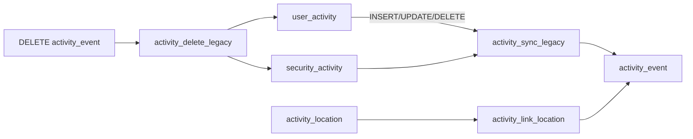

# Phase 8 — Activity migration, legacy triggers, rollback, existing data

**Date:** 2026-11-14  
**Method:** Documentation and code review only — no `db:migrate`, no disposable DB runs, no `pnpm check` (per Phase 8 worker scope).  
**Roadmap:** [auth-account-roadmap.md](./auth-account-roadmap.md) — “Verify migration, legacy-trigger, rollback, and existing-data compatibility.”  
**Legacy retirement direction:** **L1** phased removal per [requirements/activity-deeplinks-legacy-retirement.md](./requirements/activity-deeplinks-legacy-retirement.md) (partial approval 2026-11-14; full **“approved”** + **“go implement”** still open). **Transitional** dual-write and triggers remain correct until **L1e**.

## Verdict

| Area                                       | Status            | Notes                                                                                                                                 |
| ------------------------------------------ | ----------------- | ------------------------------------------------------------------------------------------------------------------------------------- |
| Migration chain (`0004`–`0006`)            | **Pass (review)** | Journal `0000`…`0011`; activity SQL only in `0004`–`0006`; later tags do not alter activity functions/triggers.                       |
| Legacy triggers (sync / delete / location) | **Pass (review)** | Behavior matches requirements and isolated tests in `tests/activity-migration-db.test.tsx`.                                           |
| Deletion guard / tombstones (`0005`)       | **Pass (review)** | Unified clear + retry rejection covered in `tests/activity-api-db.test.tsx`.                                                          |
| Provider dedupe (`0006`)                   | **Pass (review)** | `mirrorSecurityId` path in `recordProviderUnlink` + `activity_sync_legacy` replacement.                                               |
| Existing-data backfill                     | **Pass (review)** | One-shot import, duplicate ID across tables, unknown types, location `activity_id` link, owner-mismatch guard.                        |
| Rollback / apply policy                    | **Pass (review)** | `db:migrate` required; failed precondition aborts `0004` transaction; L1e restore = re-apply prior migration SQL from git.            |
| L1 retirement readiness                    | **Deferred**      | Intentional — producers still write legacy tables; legacy list/delete APIs remain; **L1b–L1f** blocked on full requirements sign-off. |

**Residual:** Re-run `tests/activity-migration-db.test.tsx` and `tests/activity-api-db.test.tsx` on a **disposable** DB before deploy sign-off ([verify/commands.md](../verify/commands.md)). This pass did not execute them.

## Migration inventory

| Tag                             | File                                                         | Role                                                                                                                                                                                                     |
| ------------------------------- | ------------------------------------------------------------ | -------------------------------------------------------------------------------------------------------------------------------------------------------------------------------------------------------- |
| `0004_shared_activity_event`    | `packages/drizzle/migrations/0004_shared_activity_event.sql` | `activity_event` table, indexes, FKs; `activity_import_legacy` backfill; sync triggers on `user_activity` / `security_activity`; `activity_link_location`; `activity_delete_legacy` on canonical delete. |
| `0005_activity_deletion_guard`  | `0005_activity_deletion_guard.sql`                           | `activity_event_tombstone`; `activity_guard_deleted_id` (INSERT); `activity_remember_deleted_id` (DELETE).                                                                                               |
| `0006_activity_provider_compat` | `0006_activity_provider_compat.sql`                          | Replaces `activity_sync_legacy` / `activity_delete_legacy` for provider-unlink mirror dedupe.                                                                                                            |

Apply with:

```bash
pnpm --filter @packages/drizzle db:migrate
```

**Do not** rely on `db:push` for production or shared environments: push does not install the custom SQL functions and triggers (`packages/drizzle/AGENTS.md`, `application-activity.md`).

## Legacy trigger behavior (transitional)



- **Sync (`activity_sync_legacy`, final form in `0006`):** Legacy row changes upsert `legacy:{user\|security}:{id}` rows; DELETE removes canonical row unless user row is a provider mirror (`mirrorSecurityId` = id) with matching security row.
- **Canonical delete (`activity_delete_legacy`):** Deleting `activity_event` removes paired legacy rows (both tables for mirrored provider unlink).
- **Location (`activity_link_location`):** Sets `activity_id` from `event_id`; enforces owner match on `security_activity` / `activity_event`; on security delete, clears `event_id` / `activity_id` but keeps coordinates.
- **Clear (app):** `unifiedActivityService.clear` deletes `activity_event` only; triggers cascade legacy cleanup (`modules/activity/src/server/services/activity.service.events.ts`). Tombstones block ID reuse (`tests/activity-api-db.test.tsx` — “clears all history without revoking sessions…”).

## Existing-data compatibility

**Backfill (`activity_import_legacy`):**

- Maps known legacy `type` values to registered `action_id` values; unknown types → `legacy.{kind}` with full legacy payload in `metadata`.
- Historical **actor** remains `unknown` (legacy tables do not store actors).
- **Duplicate IDs** across `user_activity` and `security_activity` → two canonical rows (`legacy:user:same-id`, `legacy:security:same-id`).
- **Outcome mapping** includes `failure` → `failed` and unknown → `unknown`.
- **Pre-migration guard:** `0004` raises if any `activity_location.user_id` ≠ linked `security_activity.user_id` (entire migration rolls back).

**Post-migration writes:**

- `recordUserActivity` / `recordSecurityActivity` insert legacy tables then enrich canonical row (actor, target) — triggers create/update mirror (`modules/activity/.../record.user.ts`, `record.security.ts`).
- `recordProviderUnlink` inserts security + mirrored user row; **one** canonical event (`recordProviderUnlink.ts` + `0006`).
- Native `recordActivity` / `beginActivity` write directly to `activity_event` (preferences, device auth, etc.) without legacy tables.

## Rollback and restore

| Scenario                                             | Behavior                                                                                                                                                                 |
| ---------------------------------------------------- | ------------------------------------------------------------------------------------------------------------------------------------------------------------------------ |
| Failed `0004` precondition (location owner mismatch) | Transaction aborts; no partial `activity_event` / triggers (`activity-migration-db` — “rolls back migration when…”).                                                     |
| Isolated test harness                                | Private schema + intentional throw; no persistent DB mutation (`withMigration` in `activity-migration-db.test.tsx`).                                                     |
| **Until L1e**                                        | Production must keep triggers from `db:migrate` ([activity-deeplinks-legacy-retirement.md](./requirements/activity-deeplinks-legacy-retirement.md) rollback constraint). |
| **After L1e (future)**                               | Forward-only drop migration; restore path = re-apply `0004`–`0006` SQL from git (not automated down migration).                                                          |

## Code paths vs L1 plan

| L1 slice         | Current code (2026-11-14)                                                                                        | Phase 8 finding                                                                                        |
| ---------------- | ---------------------------------------------------------------------------------------------------------------- | ------------------------------------------------------------------------------------------------------ |
| L1a Caller audit | Legacy HTTP + oRPC list/delete still exported; no in-repo app routes call `SecurityActivityScreen`               | Compatible HTTP retained per [auth-api-migration.md](./requirements/auth-api-migration.md).            |
| L1b Producers    | Profile/session hooks still use `recordUserActivity` / `recordSecurityActivity`; some flows use `recordActivity` | Expected during transition; unified feed reads `activity_event`.                                       |
| L1c Client       | UI uses `UnifiedActivityFeed` + `SecurityActivityDataManagement` → `activity.clear`                              | `SecurityActivityScreen` + `useList`/`useDelete` remain for tests/exports only.                        |
| L1d–L1f          | Not started                                                                                                      | No trigger/table drops; **do not** ship L1e without Phase 8 checklist + disposable DB migration tests. |

## Test coverage (not executed this pass)

| File                                          | Cases                                                                                | Requires `DATABASE_URL`      |
| --------------------------------------------- | ------------------------------------------------------------------------------------ | ---------------------------- |
| `tests/activity-migration-db.test.tsx`        | 7 — backfill, mirror dedupe, ongoing sync, canonical delete, constraints, FK cascade | Yes (isolated disposable DB) |
| `tests/activity-api-db.test.tsx`              | Includes clear/tombstone, actor enrichment, provider link/unlink                     | Yes                          |
| `tests/security-auth-activity-hooks.test.tsx` | Legacy ID shape from hooks                                                           | No (mocked DB)               |

## Open items (unchanged)

- Full **L1** implementation waits on [activity-deeplinks-legacy-retirement.md](./requirements/activity-deeplinks-legacy-retirement.md) **“approved”** + **“go implement”**.
- `deleteAccountHistory` (legacy table + category delete) remains in server API; tests still exercise it — prefer unified `activity.clear` for product paths.
- Deploy environments: confirm migration ledger includes `0004`–`0006` before accepting new activity traffic.

## References

- [application-activity.md](./requirements/application-activity.md) — database slice, verification 2026-11-10
- [activity-deeplinks-legacy-retirement.md](./requirements/activity-deeplinks-legacy-retirement.md) — L1 phases, rollback constraint
- `packages/drizzle/migrations/0004_shared_activity_event.sql` … `0006_activity_provider_compat.sql`
