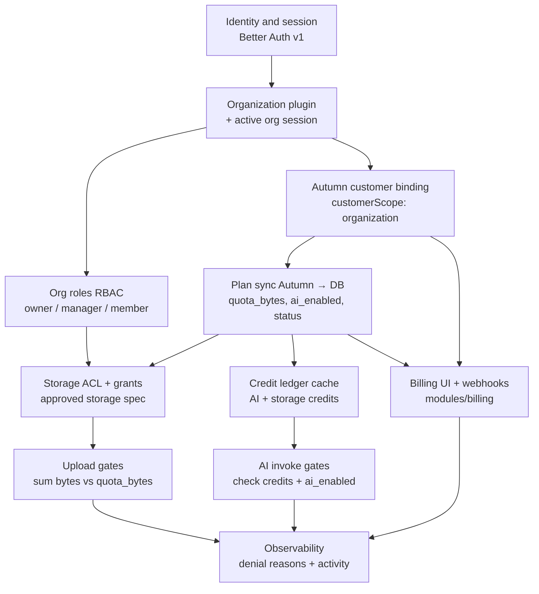

# Platform entitlements master plan

**Status:** Planning (no implementation)  
**Date:** 2026-11-14  
**Audience:** Product, platform, and implementation agents  
**Normative specs (approved):** [requirements/autumn-usage-metering.md](./requirements/autumn-usage-metering.md) · [requirements/storage-system.md](./requirements/storage-system.md) · [requirements/organizations.md](./requirements/organizations.md) · [requirements/org-roles-rbac.md](./requirements/org-roles-rbac.md) · [requirements/ai-usage-credits.md](./requirements/ai-usage-credits.md) (AI: **gates/model only**, no routes in v1)  
**Draft (org UX):** [requirements/organization-onboarding-wizard.md](./requirements/organization-onboarding-wizard.md) — 8-step create wizard + edit reuse; Phase 1 metadata, Phase 2+ normalized org tables  
**Design Q&A (planning supplement):** [requirements/entitlements-design-answers.md](./requirements/entitlements-design-answers.md)  
**Roadmap:** [auth-account-roadmap.md](./auth-account-roadmap.md) Phase 9+  
**Layers:** [layers.md](../layers.md) — `packages` → `features` → `modules` → `apps`

This document is the **single map** for auth, organizations, RBAC, subscriptions, credits, usage metering, storage quotas, AI gates, and enforcement. It does not replace requirements docs; it sequences them and lists gaps.

---

## 1. Executive summary

We are building an **organization-scoped SaaS** on a single auth domain with multiple apps (Auth, Studio, Console, Web). Users authenticate via Better Auth; **organizations** are the tenancy boundary for **storage**, **billing**, and (eventually) **AI usage**.

**Approved product model (v1):**

- **Free plan:** Users can create **1** organization per user (`organization_count`); each org gets **2 GB** included storage; **AI features off** (entitlement-gated; **no AI routes in v1**).
- **Paid plan:** **5 GB** included storage per org; **AI features enabled**; subscription and payments via **self-hosted Autumn OSS** → Stripe (not raw Stripe in-app; **not** Autumn cloud SaaS).
- **Credits:** Purchasable **AI usage credits** and **monthly storage bump** credits (consumable); balances and entitlements authoritative in **Autumn**, with a **Drizzle cache** for fast gates.

**Architecture principle:** **DB enforce + Autumn entitlements** — real-time upload and AI pre-checks use **cached limits in Postgres**; Autumn owns subscription tier, credit balances, invoicing, and plan definitions. Sync Autumn → DB on webhooks and billing events; optional async `track` to Autumn for meters (no per-upload Autumn round-trip).

**Current repo gap:** Better Auth has **no** `organization` or `autumn` plugins yet. Server plugins today: JWT/MCP OAuth, **admin**, magic link, **SSO**, **device authorization**, soft delete, public list-accounts. Client: admin, magic link, device authorization (no org/autumn client). Storage and billing shells exist in Account nav but depend on org + entitlement slices.

---

## 2. Capability map

| Capability                       | What it means                                                           | Owner (target)                                                 | Spec / state                                                                                          | Enforcement / UI                                                 |
| -------------------------------- | ----------------------------------------------------------------------- | -------------------------------------------------------------- | ----------------------------------------------------------------------------------------------------- | ---------------------------------------------------------------- |
| **Auth & session**               | Sign-in, cookies, multi-app `returnTo`, fresh session for sensitive ops | `@packages/better-auth`, `@modules/auth`, `apps/auth`          | [better-auth.md](./requirements/better-auth.md) v1 done; org **deferred**                             | Route guards; oRPC `protectedProcedure`                          |
| **Organizations**                | Create/join orgs, invitations, active org in session                    | `@packages/better-auth` `organization()`, `@modules/org` (new) | [organizations.md](./requirements/organizations.md) **Approved** (2026-11-14)                         | Session `activeOrganizationId`; switcher UI; Free **1 org/user** |
| **Roles & permissions (org)**    | Owner / manager / member at org level                                   | BA org plugin + app policy                                     | [org-roles-rbac.md](./requirements/org-roles-rbac.md) **Approved**                                    | oRPC: role from session + membership; cross-org **403**          |
| **Storage folder grants**        | Owner-only grantor; view+edit on folders/items                          | `@modules/storage`                                             | [storage-system.md](./requirements/storage-system.md) **Approved**                                    | List/upload/download; owner bypass                               |
| **Subscription plans**           | Free vs Paid per **org** customer                                       | Self-hosted Autumn dashboard + `@packages/billing`             | [autumn-usage-metering.md](./requirements/autumn-usage-metering.md) **Approved** (amended: self-host) | Upgrade/downgrade via `@modules/billing`                         |
| **Credits**                      | AI + monthly storage bumps                                              | Autumn credits + DB mirror                                     | Same                                                                                                  | Purchase UI; balance display                                     |
| **Feature flags / entitlements** | `ai_enabled`, plan tier, included bytes                                 | Autumn `check` + DB cache                                      | Approved hybrid model                                                                                 | Server gates before AI; UI hides/disabled states                 |
| **Usage metering**               | Bytes stored, AI credits consumed                                       | Drizzle sums + optional Autumn `track`                         | Approved                                                                                              | Post-upload async track optional                                 |
| **Enforcement points**           | Where requests are denied                                               | All domain modules                                             | This plan § Restrictions matrix                                                                       | 403 + stable error codes + activity                              |
| **Audit / activity**             | Org-scoped events, billing denials                                      | `@modules/activity` patterns                                   | [application-activity.md](./requirements/application-activity.md)                                     | New action IDs per domain                                        |
| **UI surfaces**                  | Account → Storage, Billing, AI (future)                                 | `@modules/storage`, `@modules/billing`                         | Shell routes exist                                                                                    | Incremental real UI per spec                                     |

---

## 3. Prerequisites dependency graph

**Critical path:** A → B → (C parallel D) → E → (F parallel G) → (H parallel I) → J → K.

**Parallel tracks after B:**

| Track                                   | Can start after         | Notes                                                                                                       |
| --------------------------------------- | ----------------------- | ----------------------------------------------------------------------------------------------------------- |
| **Org product UI** (switcher, settings) | B                       | Does not require Autumn                                                                                     |
| **Autumn + billing package**            | B                       | Needs org for `customerScope: "organization"`; **`AUTUMN_API_BASE_URL`** → self-hosted instance             |
| **Storage schema + ACL**                | B + C                   | Quota from E can use **5 GB interim constant** until E ships                                                |
| **AI metering**                         | E + G + route amendment | [ai-usage-credits.md](./requirements/ai-usage-credits.md) **Approved** for gates only — **no routes in v1** |

---

## 4. Per-domain: what’s required

### 4.1 Auth & session

**Goal:** Stable identity and session across apps; extend session with **active organization** without breaking existing Account flows.

**Checklist:**

- [ ] Add Better Auth **`organization()`** server plugin + **`organizationClient()`** in `@packages/better-auth` (after [organizations.md](./requirements/organizations.md) approved).
- [ ] Drizzle schema + migration for org tables (BA generator).
- [ ] **Active org** on session (cookie or session field per BA docs); never trust client-supplied `organizationId` alone.
- [ ] Org **switcher** in `@modules/shell` or `@modules/org`; empty state when user has zero orgs.
- [ ] Multi-app: preserve `returnTo` and shared cookie domain (existing Phase 1–2 behavior).
- [ ] Sensitive actions keep **fresh session** policy (deletion, billing purchase TBD).
- [ ] Platform **admin** role (`user.role === admin`) stays separate from **org owner** (Console vs Account).

**References:** [better-auth.md](./requirements/better-auth.md), [auth-account-roadmap.md](./auth-account-roadmap.md).

---

### 4.2 Organizations

**Goal:** Users create orgs; members join via invite; every org-scoped feature reads **active org**.

**Checklist:**

- [ ] Org CRUD: create, rename, slug, avatar path ([storage-system.md](./requirements/storage-system.md) org avatar under `loftlancer/orgs/{orgId}/avatar/`).
- [ ] Invitations: email flow, accept/decline, role on join (default **member**).
- [ ] Membership list; remove member; transfer ownership policy (TBD in org req doc).
- [ ] **Default org storage root** provisioned on org create (metadata row, not blobs yet).
- [ ] On org create: attach **Free** plan entitlements → Autumn customer + DB cache **2 GB** (after billing slice).
- [ ] Behavior when **no active org:** Storage/Billing tabs — org picker or empty state (not silent wrong-org access).

**Spec:** [organizations.md](./requirements/organizations.md) **Approved** (2026-11-14) — email invites; `organization_count` **1** on Free.

---

### 4.3 Roles & RBAC (org-level)

**Goal:** Three org roles with consistent enforcement in oRPC and UI.

| Role        | Org-wide powers (v1)                        | Billing                                       | Storage (v1)           |
| ----------- | ------------------------------------------- | --------------------------------------------- | ---------------------- |
| **Owner**   | Full org admin; sole storage grantor        | Upgrade, credits (**owner only**, 2026-11-14) | See all; manage grants |
| **Manager** | **Same as member in v1** — no invite/remove | **Billing tab hidden**                        | Granted folders only   |
| **Member**  | Baseline                                    | **Billing tab hidden**                        | Granted folders only   |

**Checklist:**

- [ ] Map BA org roles to product names (confirm BA `owner` / `admin` / `member` vs custom).
- [ ] Central **`requireOrgRole({ min: "member" })`** (or equivalent) in shared oRPC middleware.
- [ ] **403** for wrong role and **cross-org resource IDs** ([org-roles-rbac.md](./requirements/org-roles-rbac.md) R5 — not 404).
- [ ] Document difference: **platform admin** (Console) vs **org owner** (Account storage/billing).

**References:** [storage-system.md — Roles](./requirements/storage-system.md#roles-and-authorization); draft **org-roles-rbac.md**.

---

### 4.4 Permissions (storage grants vs org roles)

**Goal:** Org role alone does **not** grant storage visibility except **owner** (full tree). Manager/member need **grants**.

**Checklist:**

- [ ] Schema: `org_storage_grant` (folder or item, subject user or role — v1 user grants).
- [ ] oRPC derives `organization_id` from session; checks grant + role.
- [ ] Owner bypass on list/read/write/delete/grant mutations.
- [ ] Only owner may create/update/revoke grants (approved).
- [ ] Signed URL issuance only after grant/owner check; TTL **1 hour** (approved).

**API authorization pattern (target):**

1. Resolve session → user id.
2. Resolve **active organization** → org id + membership role.
3. Load resource → must match org id.
4. Apply role policy (owner bypass OR grant check).
5. Apply entitlement policy (quota, plan) where relevant.

---

### 4.5 Subscriptions (Free vs Paid)

**Goal:** Org-scoped subscription via Autumn; custom Account billing UI.

**Checklist:**

- [ ] `autumn-js` + Better Auth **`autumn()`** / **`autumnClient()`** in `@packages/better-auth`.
- [ ] **`customerScope: "organization"`** — one Autumn customer per org.
- [ ] Dashboard plans: **Free**, **Paid**; Stripe prices only in Autumn.
- [ ] **`AUTUMN_SECRET_KEY`** + **`AUTUMN_API_BASE_URL`** in `@packages/t3-env` (required in dev; keys from self-hosted dashboard).
- [ ] `autumn({ baseURL })` in `@packages/better-auth` (verified on `autumn-js@1.5.11`).
- [ ] `@packages/billing`: feature ID constants, webhook handler, **Autumn → DB sync**.
- [ ] `@modules/billing`: plans, usage summary, upgrade, portal entry — **no** default AttachDialog as primary UX.
- [ ] Single **`AutumnProvider`** in `apps/auth` layout (`useBetterAuth: true`).
- [ ] Downgrade/expired: sync lowers `quota_bytes`, sets `ai_enabled=false`, may block new uploads if over new cap (policy TBD).

**References:** [autumn-usage-metering.md](./requirements/autumn-usage-metering.md).

---

### 4.6 Credits

**Goal:** Purchasable consumables for AI and monthly storage increases.

**Checklist:**

- [ ] Autumn credit products for `ai_usage_credits` and storage bump feature.
- [ ] Expose balance in billing UI (Autumn API + optional DB cache).
- [ ] **Consumption:** decrement on AI invoke; storage bump semantics (monthly burn vs cap extension) — **must be decided** in requirements.
- [ ] Webhook/credit purchase → refresh DB cache fields.
- [ ] Idempotent consumption records (avoid double-charge on retry).

**Open:** Exact monthly storage credit burn vs cumulative cap ([autumn-usage-metering.md gaps](./requirements/autumn-usage-metering.md#gaps--open-questions-reduced)).

---

### 4.7 Restrictions / feature blocks (matrix)

| Condition                                    | AI features                           | Storage upload                           | Storage read         | Billing actions       | Account UI                       |
| -------------------------------------------- | ------------------------------------- | ---------------------------------------- | -------------------- | --------------------- | -------------------------------- |
| **Not signed in**                            | Deny                                  | Deny                                     | Deny                 | Deny                  | Redirect login                   |
| **Signed in, no org / no active org**        | Deny (no scope)                       | Deny                                     | Deny                 | Deny or org picker    | Storage/Billing: picker or empty |
| **Free plan, `ai_enabled=false`**            | **Block** (403 + copy)                | Allow if quota OK                        | Per grants           | Owner: upgrade        | AI surfaces hidden/disabled      |
| **Paid, `ai_enabled=true`, zero AI credits** | **Block** when meter requires credits | Allow if quota OK                        | Per grants           | Buy credits           | Show balance + CTA               |
| **At storage cap (`used >= quota_bytes`)**   | Unaffected                            | **Block** `initUpload`                   | Allow read/delete    | Buy credits / upgrade | Usage bar at 100%                |
| **Over cap after downgrade**                 | Per AI rules                          | **Block** new uploads; reads OK          | Per grants           | Upgrade               | Warn over quota                  |
| **Subscription expired / unpaid**            | **Block** AI                          | **Block** upload (entitlement downgrade) | Read-only policy TBD | Pay / resubscribe     | Banner on Billing                |
| **Wrong org role (non-member)**              | Deny                                  | Deny                                     | Deny                 | Deny                  | 403                              |
| **Member/manager, no grant**                 | N/A                                   | Deny write                               | Deny list in folder  | No billing            | Empty/hidden scope               |
| **Platform admin (Console)**                 | N/A                                   | N/A                                      | N/A                  | N/A                   | Separate Console routes          |

**Stable denial reasons (for logs/UI/i18n):** e.g. `entitlement.ai_disabled`, `entitlement.no_credits`, `quota.storage_exceeded`, `auth.no_active_org`, `rbac.forbidden`, `billing.subscription_inactive`.

---

### 4.8 Entitlement cache in DB (Drizzle)

**Goal:** Fast gates without calling Autumn on every request.

**Proposed fields (per organization — table name TBD, e.g. `org_entitlement` or columns on `organization`):**

| Field                    | Type (conceptual)                         | Source of truth              | Updated when           |
| ------------------------ | ----------------------------------------- | ---------------------------- | ---------------------- |
| `plan_tier`              | `free` \| `paid` \| …                     | Autumn subscription          | Webhook / attach       |
| `subscription_status`    | `active` \| `past_due` \| `canceled` \| … | Autumn                       | Webhook                |
| `quota_bytes`            | bigint                                    | Autumn plan + credits policy | Sync job               |
| `ai_enabled`             | boolean                                   | Autumn entitlement           | Sync job               |
| `ai_credit_balance`      | numeric (optional cache)                  | Autumn credits               | Purchase/consume/track |
| `storage_credit_balance` | numeric (optional cache)                  | Autumn credits               | Purchase/consume       |
| `autumn_customer_id`     | string                                    | Autumn                       | First billing touch    |
| `entitlements_synced_at` | timestamp                                 | App                          | Last successful sync   |

**Rules:**

- Upload gate: `sum(byte_size)` for org vs **`quota_bytes`** only (approved).
- AI gate: `ai_enabled` AND (credit balance > 0 OR included allowance — product TBD).
- On sync failure: fail-safe policy TBD (deny uploads vs last-known-good).

---

### 4.9 Autumn integration

**Checklist:**

- [ ] Plugin order: **`organization()` before `autumn()`**.
- [ ] Feature IDs (slice 1): `org_storage_bytes`, `ai_usage_credits`, `organization_count` (or seats).
- [ ] Server: `auth.api.check`, `auth.api.track` (or package wrappers).
- [ ] Webhooks: subscription created/updated/canceled, credit purchase → **sync handler** in `@packages/billing`.
- [ ] Optional async `track` after upload/delete for invoice line items.
- [ ] No raw Stripe webhook stack in app.

---

### 4.10 Storage (approved spec slices)

**Checklist (ordered):**

- [ ] **Prerequisite:** org plugin + active org ([R1](./requirements/storage-system.md#decisions-user-input-2026-11-14-round-2)).
- [ ] Schema: folders, items, grants ([storage-system.md data model](./requirements/storage-system.md#data-model-proposed--not-migrated)).
- [ ] oRPC: list, getUsage, initUpload, delete, restore, grants.*.
- [ ] MIME allowlist + **4 MB** per file on multipart route.
- [ ] Hard cap vs **`quota_bytes`** (interim 5 GB constant until Autumn sync).
- [ ] Trash + **7-day** Vercel Cron purge + `del` (org prefixes only).
- [ ] Org avatar path; personal avatars unchanged ([profile-avatar-blob.md](./requirements/profile-avatar-blob.md)).
- [ ] Storage activity action IDs.

---

### 4.11 AI billing (gates approved — routes deferred)

**Requirements:** [ai-usage-credits.md](./requirements/ai-usage-credits.md) **Approved** (2026-11-14).

**v1 deliverable (no user-facing AI):**

- [x] Requirements approved: gate pattern, denial codes, credits model, future-route enforcement checklist.
- [x] **No AI routes** in v1 — helpers/cache only; sync with billing entitlement slice.
- [ ] Meter id: `ai_usage_credits` (Autumn) — dashboard + cache fields in Phase 3–4.
- [ ] **`assertAiInvokeAllowed`** exported — **no callers** until route amendment.

**Post–v1 (Studio / Phase 9+):**

- [ ] **Before invoke:** read `ai_enabled` + credit cache per approved spec.
- [ ] **After invoke:** decrement + optional async `track`; activity (redacted).
- [ ] UI: AI usage tab / generative surfaces — **requires new sign-off naming first route**.

---

### 4.12 Observability

**Checklist:**

- [ ] Register activity action IDs: `storage.quota_denied`, `storage.upload`, `billing.plan_changed`, `ai.denied_no_credits`, etc.
- [ ] Log billing denial **reason code** server-side (no secrets).
- [ ] Org id + user id on all entitlement denials.
- [ ] Metrics (future): denied uploads, denied AI calls by reason.

**References:** [application-activity.md](./requirements/application-activity.md), activity-and-logging module docs.

---

## 5. Requirements docs: exist vs needed

| Document                                                                                | Status                                         | Role in entitlements plan                                                                                                                                 |
| --------------------------------------------------------------------------------------- | ---------------------------------------------- | --------------------------------------------------------------------------------------------------------------------------------------------------------- |
| [autumn-usage-metering.md](./requirements/autumn-usage-metering.md)                     | **Approved** · amended (self-host, 2026-11-14) | Billing, plans, credits, Autumn plugin; [infra/autumn/](../../infra/autumn/README.md) local OSS runbook                                                   |
| [storage-system.md](./requirements/storage-system.md)                                   | **Approved**                                   | Org storage, grants, quota enforcement                                                                                                                    |
| [better-auth.md](./requirements/better-auth.md)                                         | v1 done; org **deferred**                      | **Needs org slice amendment / organizations doc**                                                                                                         |
| [auth-account.md](./requirements/auth-account.md)                                       | Implemented                                    | Shell routes for Storage/Billing                                                                                                                          |
| [application-activity.md](./requirements/application-activity.md)                       | Implemented                                    | Extend with org/billing/storage events                                                                                                                    |
| [profile-avatar-blob.md](./requirements/profile-avatar-blob.md)                         | Approved                                       | Out of org quota                                                                                                                                          |
| [account-data-retention-deletion.md](./requirements/account-data-retention-deletion.md) | Draft                                          | Org dissolve / user delete vs storage                                                                                                                     |
| [organizations.md](./requirements/organizations.md)                                     | **Approved** (2026-11-14)                      | Create/join/**email** invite/active org; Free **1 org/user**                                                                                              |
| [org-roles-rbac.md](./requirements/org-roles-rbac.md)                                   | **Approved** (2026-11-14)                      | Owner/manager/member; manager=member v1; billing hidden; **403** cross-org                                                                                |
| [ai-usage-credits.md](./requirements/ai-usage-credits.md)                               | **Approved** (2026-11-14)                      | Gates/credits model; **no AI routes v1**; Studio enforcement spec                                                                                         |
| [entitlements-design-answers.md](./requirements/entitlements-design-answers.md)         | Planning supplement                            | Concrete v1 policies for AI, Autumn, RBAC, orgs, storage, verification                                                                                    |
| `billing-ui.md` (optional future slug)                                                  | **Not created**                                | Billing UI in [autumn-usage-metering.md](./requirements/autumn-usage-metering.md) (`@modules/billing`); split to own requirements doc only if scope grows |
| **platform-entitlements-plan.md** (this doc)                                            | Planning                                       | Master map — not a substitute for sign-off                                                                                                                |

**Update when drafting:** Amend [better-auth.md](./requirements/better-auth.md) “Orgs & roles deferred” once org slice is scoped in `organizations.md`.

---

## 6. Implementation phases

Phases assume [workflow/04-requirements-first.md](../workflow/04-requirements-first.md): approve requirements before code.

| Phase  | Name                          | Depends on                    | Deliverables                                                                                                                                                                                                   | Parallel?                           |
| ------ | ----------------------------- | ----------------------------- | -------------------------------------------------------------------------------------------------------------------------------------------------------------------------------------------------------------- | ----------------------------------- |
| **0**  | Requirements pack             | —                             | **Complete (2026-11-14)** — [organizations.md](./requirements/organizations.md), [org-roles-rbac.md](./requirements/org-roles-rbac.md), [ai-usage-credits.md](./requirements/ai-usage-credits.md) **Approved** | —                                   |
| **1**  | Organization foundation       | Phase 0                       | BA `organization` plugin, schema, active org, switcher, empty states                                                                                                                                           | —                                   |
| **2**  | Org RBAC enforcement          | Phase 1                       | Membership roles, oRPC middleware, org settings UI skeleton                                                                                                                                                    | **∥** start Autumn dashboard config |
| **3**  | Entitlement schema + sync     | Phase 1                       | Drizzle entitlement columns/table; default Free **2 GB** on org create                                                                                                                                         | Requires Phase 1                    |
| **4**  | Autumn + `@packages/billing`  | Phase 1–3                     | Plugins, env (`AUTUMN_SECRET_KEY`, **`AUTUMN_API_BASE_URL`**), webhooks, Autumn → DB sync against **self-hosted OSS** — **no** Autumn cloud SaaS                                                               | **∥** with late Phase 2             |
| **5**  | `@modules/billing` UI         | Phase 4                       | Custom plans, credits, invoices, upgrade                                                                                                                                                                       | After 4                             |
| **6**  | Storage foundation            | Phase 2–3                     | Schema, getUsage, overview UI, interim quota constant                                                                                                                                                          | **∥** with 4–5 if 3 done            |
| **7**  | Storage upload + ACL          | Phase 6                       | Upload, grants, signed URLs, quota gate                                                                                                                                                                        | —                                   |
| **8**  | Storage trash + org avatar    | Phase 7                       | Cron purge, org avatar                                                                                                                                                                                         | —                                   |
| **9**  | AI gates + routes             | Phase 4 + **route amendment** | First invoke routes, metering UI — **not in v1**; cache/helper in Phase 3–4 OK                                                                                                                                 | After named Studio/Auth route       |
| **9b** | **Vercel AI Gateway** (later) | **First AI HTTP route ships** | Provider routing; **internal spend tags by `organizationId`** for cost attribution — **not** customer billing (Autumn remains customer meter)                                                                  | **Deferred** until Phase 9 route    |
| **10** | Observability + i18n          | Phases 6–9                    | Activity IDs, denial copy en-us/en-in/es-es                                                                                                                                                                    | Rolling                             |

**Roadmap alignment:** [auth-account-roadmap.md](./auth-account-roadmap.md) Phase 9 items map to Phases 1–9 here.

---

## 7. Decision log / open items

**Decided (approved specs):**

| Topic                         | Decision                                                                    | Source                                                                          |
| ----------------------------- | --------------------------------------------------------------------------- | ------------------------------------------------------------------------------- |
| Quota model                   | 2 GB Free / 5 GB Paid + credits; DB enforces `quota_bytes`                  | autumn + storage                                                                |
| Billing vendor                | **Self-hosted Autumn OSS** + Stripe via Autumn; custom billing UI           | autumn (amended 2026-11-14)                                                     |
| Autumn hosting                | **Self-host OSS** — app uses `AUTUMN_API_BASE_URL`; no cloud SaaS           | User decision 2026-11-14                                                        |
| AI provider routing           | **Vercel AI Gateway** when first AI route ships — orgId spend tags only     | User decision 2026-11-14 (not customer billing)                                 |
| Customer scope                | Organization                                                                | autumn                                                                          |
| Storage tenancy               | Org-scoped; owner sole grantor                                              | storage                                                                         |
| Upload gate SoT               | Drizzle sum vs cached limit; no per-upload Autumn check                     | autumn Q2                                                                       |
| Dev Autumn key                | `AUTUMN_SECRET_KEY` + `AUTUMN_API_BASE_URL` required (shared self-host dev) | autumn Q5, amendment 2026-11-14                                                 |
| Org **billing role**          | **Owner only** — upgrade, buy credits, invoices / portal                    | User decision 2026-11-14; [org-roles-rbac.md](./requirements/org-roles-rbac.md) |
| **Billing tab (non-owner)**   | **Hidden** for manager and member                                           | 2026-11-14; [org-roles-rbac.md](./requirements/org-roles-rbac.md) R7            |
| **Manager (v1)**              | **Same as member** — no invite/remove until future amendment                | 2026-11-14; [org-roles-rbac.md](./requirements/org-roles-rbac.md) R6            |
| **Cross-org access**          | **403 Forbidden** (not 404)                                                 | 2026-11-14; [org-roles-rbac.md](./requirements/org-roles-rbac.md) R5            |
| **Free `organization_count`** | **1** org per user                                                          | 2026-11-14; [organizations.md](./requirements/organizations.md) O7              |
| **Invitations**               | **Email** (Resend when available); owner sends                              | 2026-11-14; [organizations.md](./requirements/organizations.md) O9              |
| **AI v1 scope**               | **No AI routes** — gates, credits model, enforcement spec for later only    | 2026-11-14; [ai-usage-credits.md](./requirements/ai-usage-credits.md) A6        |

**Still TBD (must resolve in requirements before implement):**

| Item                                                          | Impact                                     |
| ------------------------------------------------------------- | ------------------------------------------ |
| **Storage credit semantics** (monthly burn vs cap bump)       | `quota_bytes` calculation                  |
| **Autumn customer** on org delete                             | Billing + data retention                   |
| **AI first route** (Studio vs Auth module)                    | Phase 9 — **deferred** past v1 AI approval |
| **Webhook route** placement (`apps/auth` only?)               | Ops + security                             |
| **Over-quota after downgrade** (read-only vs delete pressure) | UX + enforcement                           |
| **Fail-safe** if entitlement cache stale                      | Upload/AI behavior                         |
| **No-org user** default for Storage/Billing                   | Shell UX                                   |
| **i18n** for all denial codes                                 | Phase 10                                   |

---

## 8. Layer map (implementation owners)

| Concern                            | Package / module                          | App                           |
| ---------------------------------- | ----------------------------------------- | ----------------------------- |
| BA plugins (org, autumn)           | `@packages/better-auth`                   | —                             |
| Autumn server, webhooks, constants | `@packages/billing` (new)                 | webhook routes in `apps/auth` |
| Env                                | `@packages/t3-env`                        | —                             |
| Org product UI                     | `@modules/org` (new)                      | thin routes                   |
| Billing UI + oRPC                  | `@modules/billing` (new)                  | Account billing section       |
| Storage domain                     | `@modules/storage` (new)                  | Account storage section       |
| Entitlement read helpers           | `@packages/billing` or `@modules/billing` | —                             |
| Shell nav / switcher               | `@modules/shell`                          | `apps/auth`                   |
| AI (future)                        | TBD module                                | Studio/Web routes             |

---

## 9. Related links

- [auth-account-roadmap.md](./auth-account-roadmap.md) — phased Account work; **master plan pointer at top**
- [requirements/README.md](./requirements/README.md) — requirements index
- [requirements/entitlements-design-answers.md](./requirements/entitlements-design-answers.md) — entitlements design Q&A (hold/settle, webhooks, quota interim, Blob access)
- Better Auth plugins (server, 2026-11-14): admin, magic link, SSO, device authorization, MCP OAuth/JWT, soft delete, list-accounts public — **not** organization or autumn

---

## Document control

| Version | Date       | Change                                                                                                                                              |
| ------- | ---------- | --------------------------------------------------------------------------------------------------------------------------------------------------- |
| 0.1     | 2026-11-14 | Initial master plan from approved autumn + storage specs                                                                                            |
| 0.2     | 2026-11-14 | Draft requirements: organizations, org-roles-rbac, ai-usage-credits; billing owner-only decided                                                     |
| 0.3     | 2026-11-14 | **Phase 0 complete** — org, RBAC, AI specs **Approved**; org_count=1; email invites; manager v1; billing hidden; 403 cross-org; **no AI routes v1** |
| 0.4     | 2026-11-14 | **Billing path:** self-hosted Autumn OSS + `AUTUMN_API_BASE_URL`; Phase **4** note; Phase **9b** AI Gateway (org spend tags, not customer billing)  |

**This is a planning doc.** Implementation requires approved requirements per slice and user sign-off recorded in each spec. [autumn-usage-metering.md](./requirements/autumn-usage-metering.md) self-host amendment **approved** (2026-11-14).
