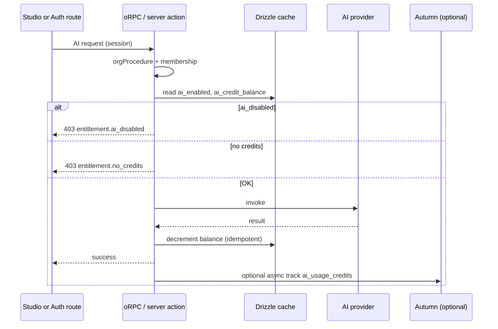

# Requirements: AI usage and credits

**Status:** Approved  
**Approved by:** User batch sign-off — **2026-11-14** (v1 scope: **gate patterns and credits model only** — **no AI routes** in v1)  
**Date:** 2026-11-14  
**Layers:** packages / features / modules / apps  
**Related:**

| Doc                                                                                     | Relationship                                                                                          |
| --------------------------------------------------------------------------------------- | ----------------------------------------------------------------------------------------------------- |
| [autumn-usage-metering.md](./autumn-usage-metering.md)                                  | **Approved** — `ai_usage_credits` feature; **AI on Paid, off Free**; DB enforce + Autumn entitlements |
| [organizations.md](./organizations.md)                                                  | **Approved** — active org required for all AI meters                                                  |
| [org-roles-rbac.md](./org-roles-rbac.md)                                                | **Approved** — org context + roles on invoke paths                                                    |
| [storage-system.md](./storage-system.md)                                                | **Approved** — separate from AI; shared entitlement cache pattern                                     |
| [platform-entitlements-plan.md](../platform-entitlements-plan.md)                       | Restriction matrix, denial codes, Phase 9                                                             |
| [entitlements-design-answers.md](./entitlements-design-answers.md#ai-usage-and-credits) | v1 hold/settle, idempotency, async track, debit edge cases                                            |

## Goal

Gate **organization-scoped AI features** by **plan entitlements** and **consumable AI credits**: **Free orgs cannot invoke AI**; **Paid orgs** have **`ai_enabled`** and must have **credit balance &gt; 0** (per v1 gate) before invoke; consumption updates **DB cache** immediately and **optionally** syncs to Autumn via async **`track`**. Non-owners purchase credits via Billing ([org-roles-rbac.md](./org-roles-rbac.md)).

## v1 scope (approved 2026-11-14)

| In v1 (this approval)                                                                                          | Not in v1                                                             |
| -------------------------------------------------------------------------------------------------------------- | --------------------------------------------------------------------- |
| **Normative gate pattern** — `assertAiInvokeAllowed`, denial codes, org context                                | **No AI HTTP routes**, oRPC AI procedures, or Studio metered features |
| **Credits + entitlement model** — cache fields, consumption ledger design, Autumn `ai_usage_credits` alignment | **No** Account “AI usage” tab or generative UI surfaces               |
| **Enforcement spec** for future routes (below) — copy into first Studio/Auth AI slice                          | Wiring **first invoke route** (Phase 9 / post–Studio land)            |

**Implementers:** Land entitlement cache fields and helpers in **billing/org slices** as needed; **do not** ship user-facing AI or debit-on-invoke until a follow-up requirements amendment names the first route.

## Product rules (from approved Autumn spec)

| Plan     | `ai_enabled` | Included AI usage                            | Credit purchase                         |
| -------- | ------------ | -------------------------------------------- | --------------------------------------- |
| **Free** | **false**    | None                                         | N/A (upgrade first)                     |
| **Paid** | **true**     | **TBD** — credits-only vs included allowance | **Owner** buys `ai_usage_credits` packs |

Credit packs and Stripe prices live in **Autumn dashboard** only ([autumn-usage-metering.md](./autumn-usage-metering.md)).

## In scope (after approval)

- [ ] **Pre-invoke gate** (synchronous, DB cache): `ai_enabled === true` **AND** `ai_credit_balance > 0` (field names on org entitlement cache per [platform-entitlements-plan.md](../platform-entitlements-plan.md) §4.8).
- [ ] **Post-invoke consumption:** decrement cached balance; record idempotent usage row; optional async `auth.api.track` / Autumn `track` for `ai_usage_credits` (**not** blocking response).
- [ ] **Organization context required** — no user-level AI meter in v1; derive org from session ([organizations.md](./organizations.md)).
- [ ] **Stable denial codes** for UI/i18n/activity ([platform-entitlements-plan.md](../platform-entitlements-plan.md)):
  - `entitlement.ai_disabled` — Free or downgraded org
  - `entitlement.no_credits` — Paid but zero balance
  - `auth.no_active_org` — no tenancy
  - `rbac.forbidden` — not a member
  - `billing.subscription_inactive` — past due / canceled (when subscription gate added)
- [ ] **Feature blocks in UI** — hide or disable AI surfaces when `ai_enabled` false; show balance + owner CTA to buy credits when enabled but empty.
- [ ] **Credit purchase** — flows only in `@modules/billing`; **owner only**; webhook refreshes `ai_credit_balance` cache.
- [ ] **Activity** — e.g. `ai.denied_no_credits`, `ai.invoke` (metadata redacted) per [application-activity.md](./application-activity.md).

## Out of scope (default)

- **All AI product routes in v1** — no `/api` or oRPC invoke endpoints; no Studio generative features (gates documented for **later** only).
- Model routing, prompt storage, or provider keys (separate AI platform work).
- Personal / user-scoped AI without org.
- Raw Stripe metering in app.
- Storage credit consumption semantics ([autumn-usage-metering.md](./autumn-usage-metering.md) gaps — separate from this doc).
- Per-route pricing tables in repo (Autumn dashboard SoT).

## Architecture (layer map)

| Decision            | Proposed owner                                                                            | Notes                                                      |
| ------------------- | ----------------------------------------------------------------------------------------- | ---------------------------------------------------------- |
| Entitlement fields  | `@packages/drizzle`                                                                       | `ai_enabled`, `ai_credit_balance` on org entitlement cache |
| Gate helper         | `@packages/billing` or `@modules/billing`                                                 | `assertAiInvokeAllowed(orgId)` reads DB                    |
| Consumption ledger  | `@packages/drizzle`                                                                       | Idempotency key per invoke/request id                      |
| Autumn track        | `@packages/billing`                                                                       | Async after success                                        |
| AI route handlers   | **TBD module** — see [First routes placeholder](#first-routes-placeholder-studio-vs-auth) | Call gate before provider                                  |
| Account AI usage UI | `@modules/billing` or dedicated AI usage tab                                              | Balance, recent usage — roadmap Phase 9                    |
| oRPC                | Same as storage                                                                           | `orgProcedure` + entitlement check                         |

## Pre-invoke and post-invoke flow

**Cache miss / stale:** On org upgrade or credit purchase, webhook/sync refreshes cache ([autumn-usage-metering.md](./autumn-usage-metering.md)). Fail-safe if cache stale — **TBD** (deny vs last-known-good); default **deny AI invoke** if `entitlements_synced_at` older than threshold — open question.

**Consumption unit:** 1 invoke = 1 credit minimum for v1 unless dashboard defines fractional — **TBD** pack size and debit amount per operation type.

## Restrictions matrix (AI column)

Aligned with [platform-entitlements-plan.md](../platform-entitlements-plan.md) §4.7:

| Condition                          | AI behavior                                                           |
| ---------------------------------- | --------------------------------------------------------------------- |
| Not signed in                      | Deny — login                                                          |
| No active org                      | `auth.no_active_org`                                                  |
| Free / `ai_enabled=false`          | **Block** — `entitlement.ai_disabled`; UI hidden/disabled             |
| Paid, `ai_enabled=true`, balance 0 | **Block** — `entitlement.no_credits`; show buy credits (owner)        |
| Paid, balance &gt; 0               | Allow invoke subject to route existing                                |
| Subscription inactive              | **Block** — `billing.subscription_inactive` (policy TBD with billing) |

Storage upload/read unaffected by AI gates except shared org context.

## Future routes — enforcement spec (when Studio or Auth AI lands)

_Approved patterns only — **no route ships in v1**._

Every new AI invoke endpoint (oRPC or route handler) **must**:

1. Compose **`orgProcedure`** → membership + active org ([org-roles-rbac.md](./org-roles-rbac.md)).
2. Call **`assertAiInvokeAllowed(organizationId)`** before any provider call — read DB cache: `ai_enabled`, `ai_credit_balance`, optional `subscription_status` / `entitlements_synced_at`.
3. On deny, return **403** with stable codes (`entitlement.ai_disabled`, `entitlement.no_credits`, `auth.no_active_org`, `rbac.forbidden`, `billing.subscription_inactive`); cross-org resource → **403** (`rbac.cross_org`), not 404.
4. On allow, invoke provider; on **success**, decrement balance in a **single transaction** with idempotency key (client `x-idempotency-key` or request id).
5. Fire **optional async** Autumn `track` for `ai_usage_credits` — never block response.
6. Emit **activity** with reason code; redact prompts/tokens in metadata.
7. **UI:** hide/disable AI chrome when `ai_enabled === false`; when enabled and balance 0, block invoke + owner **buy credits** CTA (Billing tab owner-only per RBAC).

**Candidate surfaces (deferred — amend spec when slice 1 is chosen):**

| Candidate surface               | App           | Notes                                         |
| ------------------------------- | ------------- | --------------------------------------------- |
| Account → AI usage / limits tab | `apps/auth`   | Read-only usage + balance; ties to billing    |
| First generative feature        | `apps/studio` | First metered invoke — **module + route TBD** |
| Assistive feature               | `apps/auth`   | Optional dogfood — **TBD**                    |

## Environment

| Variable            | Required      | Purpose                                                                  |
| ------------------- | ------------- | ------------------------------------------------------------------------ |
| `AUTUMN_SECRET_KEY` | Yes           | Credits + track ([autumn-usage-metering.md](./autumn-usage-metering.md)) |
| AI provider keys    | TBD per route | Not in this doc                                                          |
| `DATABASE_URL`      | Yes           | Balance cache + ledger                                                   |

## Plugins / integrations

| Capability                       | v1                                                    |
| -------------------------------- | ----------------------------------------------------- |
| Autumn `ai_usage_credits`        | **Yes**                                               |
| Better Auth org + autumn plugins | **Required** ([organizations.md](./organizations.md)) |

## Decisions (pre-filled from approved / user input)

| #                      | Topic                                                                                                                   | Decision |
| ---------------------- | ----------------------------------------------------------------------------------------------------------------------- | -------- |
| **A1 — Plan gate**     | **AI off on Free**, **on on Paid** ([autumn-usage-metering.md](./autumn-usage-metering.md) Q7)                          |
| **A2 — Pre-check SoT** | **DB cache** — `ai_enabled` + `ai_credit_balance`; no per-invoke Autumn round-trip as SoT                               |
| **A3 — Post-track**    | Optional **async** Autumn `track` for invoices                                                                          |
| **A4 — Tenancy**       | **Organization** — link active org on every invoke                                                                      |
| **A5 — Purchase**      | Credits via Autumn; **owner-only** billing UI ([org-roles-rbac.md](./org-roles-rbac.md))                                |
| **A6 — v1 delivery**   | **No AI routes in v1** — approve **gate patterns**, credits model, denial codes, and future-route enforcement spec only |
| **A7 — Cross-org**     | AI resources in another org → **403** ([org-roles-rbac.md](./org-roles-rbac.md) R5)                                     |

## Gaps / open questions

### Resolved at sign-off (2026-11-14)

- [x] **First metered routes** — **Deferred**; v1 has **no routes**; enforcement checklist above is normative for next amendment.

### Needs sign-off (deferred past v1)

- [ ] **Debit model** — flat 1 credit per request vs tokens/cost-based debit.
- [ ] **Paid included allowance** — any free credits per month on Paid or credits-only?
- [ ] **Partial failure** — provider error after debit: refund credit policy.
- [ ] **Idempotency** — client retry key format; max replay window.
- [ ] **Fail-safe stale cache** — deny vs allow with Autumn `check` on miss.
- [ ] **Role restrictions** — all members invoke equally or manager-only for some routes?
- [ ] **Console / platform admin** — bypass credits for support? (default **no**)
- [ ] **i18n** — denial copy for three locales on AI surfaces.

## Additional findings to resolve before implementation

- **Proposed approach:** A transactional hold/settle/release ledger and a durable tracking outbox are described in the [design answers](./entitlements-design-answers.md#ai-usage-and-credits). Preserve unknown provider outcomes for reconciliation; do not assume an expired hold proves the provider failed. Replay and balance reconciliation remain implementation blockers.

These findings do not change the approved v1 scope; invoke behavior remains deferred until a route amendment.

- **Concurrent spending:** A balance check followed by a post-provider debit permits concurrent requests to spend the same credits. Define atomic reservation, settlement, and release, including operations costing more than the available balance.
- **Provider and database failures:** Specify recovery when the provider succeeds but the response or debit is lost, and when calls time out, are cancelled, or finish after a subscription change.
- **Replay protection:** A ledger entry alone does not prevent a retry from calling the provider twice. Define request-key scope, concurrent retry behavior, and replayed results.
- **Balance synchronization:** Define how purchases, refunds, expiry, downgrades, local reservations and debits reconcile with Autumn without stale snapshots overwriting local activity.
- **Usage delivery:** Optional asynchronous tracking needs a durable delivery, retry, deduplication, reconciliation, and alerting policy if Autumn balances or invoices depend on it.
- **Credit arithmetic and lifecycle:** Define precision, rounding, expiry, refunds, and treatment of remaining credits across plan changes.
- **Errors and observability:** Distinguish provider failures from entitlement denials; monitor reservation, settlement, and synchronization failures without logging sensitive content.

## Implementation slices (after approval)

**v1 (org/billing platform — no AI UX):**

1. Entitlement cache fields (`ai_enabled`, `ai_credit_balance`) + sync from Autumn webhooks (overlap billing slice).
2. **`assertAiInvokeAllowed`** + consumption ledger schema + idempotency design (**exported helper**, no callers in v1).
3. Shell: **no** AI nav entries; ensure Billing credit purchase can refresh `ai_credit_balance` for future use.

**Post–v1 (requires route amendment):**

4. Wire **first named route(s)** per enforcement spec + optional track.
5. Account UI — balance, disabled states, owner purchase CTA.
6. Activity action IDs + server logging by reason code.
7. i18n for denial codes.

## Validation checklist (before sign-off)

- [x] Pre-invoke conditions explicit (`ai_enabled` + balance)
- [x] Post-invoke track optional and non-blocking documented
- [x] Denial codes listed and mapped to UI behavior
- [x] First routes **explicitly deferred** — v1 **no routes**; future enforcement spec documented
- [x] Org context required on all AI paths (future)
- [x] Cross-links to autumn, org, RBAC, platform plan
- [x] User confirmed sign-off — **2026-11-14**

## Approval

**Sign-off record:**

- [x] User: **APPROVED** **2026-11-14** (batch: gates/model only, **no AI routes in v1**)

**Workflow:** [../../workflow/04-requirements-first.md](../../workflow/04-requirements-first.md)
