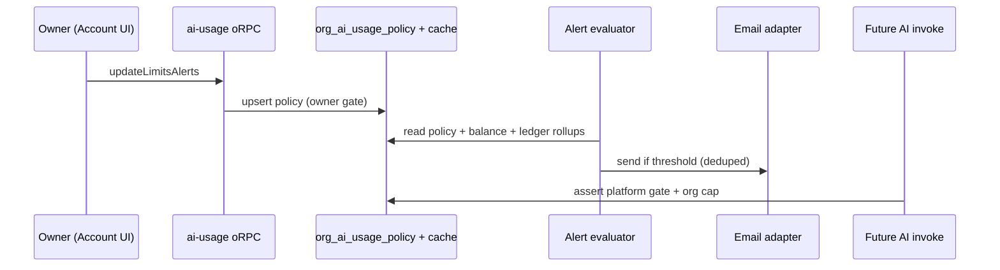

# Requirements: AI usage limits and alerts (AUTH-AI-LIMIT-01)

**Status:** **Approved — Slice 1 (alerts prefs UI + persistence)**  
**Approved by:** Phase 9 batch L1–L8 (2026-11-15)  
**Date:** 2026-11-14 (requirements review — item **119**)  
**Layers:** packages / modules / apps  
**Report ID:** [AUTH-AI-LIMIT-01](../auth-page-action-report.md#limits-and-alerts--authen-usaccountai-usagelimits-alerts)  
**Related:**

| Doc                                                                                     | Relationship                                                                                     |
| --------------------------------------------------------------------------------------- | ------------------------------------------------------------------------------------------------ |
| [ai-usage-credits.md](./ai-usage-credits.md)                                            | **Approved** — platform gates (`ai_enabled`, `ai_credit_balance > 0`); no invoke routes in v1    |
| [autumn-usage-metering.md](./autumn-usage-metering.md)                                  | **Approved** — credit packs, Autumn SoT; ops reconciliation alerts (not end-user product alerts) |
| [org-roles-rbac.md](./org-roles-rbac.md)                                                | **Approved** — owner-only billing; members may read AI usage overview                            |
| [account-notifications.md](./account-notifications.md)                                  | **Draft** — per-user notification prefs; delivery channel strategy for alert emails              |
| [phase-9-product-decisions-request.md](../phase-9-product-decisions-request.md)         | Batch **B** (B3 defers this tab); new batch **L** below for limits-specific decisions            |
| [entitlements-design-answers.md](./entitlements-design-answers.md#ai-usage-and-credits) | Hold/settle ledger, drift alerting for ops — distinct from Account “limits & alerts” UX          |

## Goal

Let **organization owners** configure **optional spend guardrails** and **low-balance / threshold notifications** for org-scoped AI credits, and let **all org members** see which guardrails apply—without duplicating platform entitlement enforcement already defined in [ai-usage-credits.md](./ai-usage-credits.md).

## Problem statement (review item 119)

The Account tab **`/account/ai-usage/limits-alerts`** exists in nav but renders a **blocked empty state** (`AiUsageLimitsAlertsPage` → `AiUsageDeferredTabScreen`). i18n states limits are **not defined in requirements**. There is **no** oRPC, schema, cron, or email hook for thresholds. [phase-9-product-decisions-request.md](../phase-9-product-decisions-request.md) **B3** recommends **not** shipping model/history/limits sub-tabs until invoke routes exist; **A1** recommends **keeping** the AI nav with honest placeholders.

This doc separates three concepts that the UI label merges:

| Concept                    | Owner today                                                                                          | User-configurable in this feature?               |
| -------------------------- | ---------------------------------------------------------------------------------------------------- | ------------------------------------------------ |
| **Platform entitlement**   | `ai_enabled`, `ai_credit_balance`, subscription state ([ai-usage-credits.md](./ai-usage-credits.md)) | **No** — Autumn + DB cache                       |
| **Hard stop at zero**      | `assertAiInvokeAllowed` → `entitlement.no_credits`                                                   | **No** — not a preference                        |
| **Org policy “limits”**    | Not implemented                                                                                      | **Proposed** — optional caps (e.g. monthly burn) |
| **Alerts / notifications** | Not implemented                                                                                      | **Proposed** — thresholds + delivery             |

**Storage analogy:** [storage-system.md](./storage-system.md) enforces **plan-derived** `quota_bytes` with overview progress and activity on deny—there is **no** user-defined storage alert prefs in v1. AI limits tab is **additional** product scope, not a mirror of storage quota UI.

## In scope (proposed — not approved)

- [ ] **Read UI** on limits tab: current org policy (if any), preset threshold labels, last alert sent timestamp (owner-only detail TBD).
- [ ] **Owner write UI**: enable/disable alert presets; optional monthly **org spend cap** in credits (blocked invoke when cap reached, even if Autumn balance &gt; 0).
- [ ] **oRPC** under `ai-usage` (or `billing` if product prefers): `getLimitsAlerts`, `updateLimitsAlerts` — `storageOrgProcedure` + **owner gate** for mutations (align [org-roles-rbac.md](./org-roles-rbac.md) R3 pattern: billing mutations owner-only).
- [ ] **Drizzle** table `org_ai_usage_policy` (name TBD at implement) keyed by `organization_id`: caps, threshold flags, `updated_at`.
- [ ] **Evaluator** on credit debit path (post–v1 invoke routes): after platform gate passes, check org cap; deny with new stable code e.g. `entitlement.org_ai_cap_exceeded` (must be added to platform plan + i18n).
- [ ] **Alert dispatcher** (cron or event-driven on balance change): compare balance / burn rate to prefs; enqueue email to configured recipients.
- [ ] **Activity** — e.g. `ai.alert.sent`, `ai.policy.updated` (metadata: threshold id, no PII).
- [ ] i18n (`en-us`, `en-in`, `es-es`) for tab chrome and denial copy.

## Out of scope (v1 proposal)

- Per-member or per-model limits (defer to model-usage spec / Studio metering).
- User-level AI limits (tenancy is **org-only** per [ai-usage-credits.md](./ai-usage-credits.md) A4).
- In-app notification inbox (see [account-notifications.md](./account-notifications.md) — v1 proposal is **no** feed).
- SMS, Slack, webhooks for alerts (unless batch **L** approves).
- Autumn dashboard configuration of thresholds (product caps stay in app DB; Autumn remains credits SoT).
- **Implementing** invoke routes or ledger producers (prerequisite amendment to [ai-usage-credits.md](./ai-usage-credits.md)).

## Architecture (layer map)

| Decision              | Proposed owner                                   | Notes                                                                               |
| --------------------- | ------------------------------------------------ | ----------------------------------------------------------------------------------- |
| Policy persistence    | `@packages/drizzle`                              | One row per org; migrations after approval                                          |
| Policy read (members) | `@modules/ai-usage`                              | Same `storageOrgProcedure` as overview                                              |
| Policy write          | `@modules/ai-usage`                              | Owner procedure (mirror `storageOrgOwnerProcedure` / billing owner gate)            |
| Pre-invoke gate       | `@packages/billing`                              | Extend `assertAiInvokeAllowed` **only after** cap fields + invoke routes approved   |
| Alert send            | `@modules/notifications` or billing mail adapter | Reuse email path when Resend approved; until then **log + activity only** (dry-run) |
| Account UI            | `@modules/ai-usage`                              | Replace `AiUsageLimitsAlertsPage` blocked shell                                     |
| Routes                | `apps/auth`                                      | Thin `limits-alerts/page.tsx` (already exists)                                      |

## End-to-end flow (proposed)

### Configure (owner)

1. Owner opens **AI usage → Limits & alerts** with active org selected.
2. FormKit form: toggle alert presets (e.g. balance ≤ 25% of last top-up, ≤ 10 credits, at zero); optional numeric **monthly credit cap** (integer ≥ 1).
3. oRPC `updateLimitsAlerts` validates caps ≤ cached balance semantics (TBD: cap vs balance).
4. Server writes `org_ai_usage_policy`; activity `ai.policy.updated`.

### Notify (system)

1. On webhook credit purchase, invoke settlement, or **hourly cron**, job loads org policy + `ai_credit_balance` + optional rolling **credits consumed this calendar month** from ledger.
2. If threshold crossed and not already notified for this **period bucket** (dedupe key TBD), send email to **org owner email** (default) and record `ai_alert_delivery` row.
3. Emit `ai.alert.sent` activity.

### Enforce cap (post–v1 invoke)

1. Studio/auth invoke calls `assertAiInvokeAllowed` then **`assertOrgAiUsageCapAllowed`** (proposed).
2. If monthly burn ≥ cap → **403** `entitlement.org_ai_cap_exceeded`; UI copy on limits tab explains block; members see read-only cap.

## Authorization

| Action              | Owner         | Manager  | Member |
| ------------------- | ------------- | -------- | ------ |
| View policy + prefs | Yes           | Yes      | Yes    |
| Edit prefs / caps   | Yes           | **No**   | **No** |
| Receive alert email | Yes (default) | TBD (L4) | TBD    |

Cross-org → **403** `rbac.cross_org` (unchanged). No active org → same empty state as overview (`auth.no_active_org` pattern in UI).

## Environment

| Variable            | Required              | Purpose                                        |
| ------------------- | --------------------- | ---------------------------------------------- |
| `DATABASE_URL`      | Yes                   | Policy + dedupe tables                         |
| `CRON_SECRET`       | If cron evaluator     | Secured route pattern from storage purge       |
| `RESEND_API_KEY`    | For real email        | Phase 12 / notifications approval              |
| `AUTUMN_SECRET_KEY` | For balance freshness | Read cache fields only; no threshold in Autumn |

## Plugins / integrations

| Capability                   | v1 proposal                                                                                                |
| ---------------------------- | ---------------------------------------------------------------------------------------------------------- |
| Better Auth org              | **Required** — active org + membership                                                                     |
| Autumn credits               | Balance SoT via existing cache sync                                                                        |
| Email                        | **Owner email** from BA user record unless L4 expands                                                      |
| Account notifications module | Optional shared `enqueueNotification` when [account-notifications.md](./account-notifications.md) approved |

## Decision batch L — AI limits & alerts (product)

_Add to [phase-9-product-decisions-request.md](../phase-9-product-decisions-request.md) after coordinator merge._

| ID  | Question                                                                                              | **Recommended default**                                                                                      |
| --- | ----------------------------------------------------------------------------------------------------- | ------------------------------------------------------------------------------------------------------------ |
| L1  | Ship limits tab before first **metered invoke** route?                                                | **Alerts-only first** (balance thresholds); **monthly cap enforcement** only after invoke + ledger amendment |
| L2  | Who may **edit** prefs?                                                                               | **Owner only**; all members **read**                                                                         |
| L3  | Preset thresholds v1                                                                                  | **Fixed presets**: “Low balance” (&lt; 10 credits), “Very low” (&lt; 3), “Depleted” (0) — **no custom %**    |
| L4  | Alert recipients                                                                                      | **Org owner email only**; no member opt-in in v1                                                             |
| L5  | Delivery channel v1                                                                                   | **Email** when provider available; else **activity + owner-visible banner** on AI overview only              |
| L6  | Monthly org **spend cap**                                                                             | **Off by default**; owner enables integer cap; denies invoke with `entitlement.org_ai_cap_exceeded`          |
| L7  | Cap period                                                                                            | **Calendar month UTC**; reset on 1st; consumption from `ai_credit_ledger` settled rows only                  |
| L8  | Tab visibility vs [B3](../phase-9-product-decisions-request.md#decision-batch-b--ai-usage-account-ui) | **Keep tab** with honest copy until **L1** approved slice ships; do not hide nav per **A1**                  |

**Reply format:** `Approved L1–L8 defaults` or list exceptions (e.g. `L3: custom thresholds`).

## Gaps / open questions

### Resolved by review (documentation only)

- [x] Tab is **blocked by design** until this spec is approved — not a bug.
- [x] Platform **zero balance** stop is **not** configurable here ([ai-usage-credits.md](./ai-usage-credits.md)).

### Needs sign-off

- [ ] **L1–L8** (batch L above).
- [ ] **Dedupe window** — one email per threshold per month vs per crossing event.
- [ ] **Cap vs balance** — if cap &gt; Autumn balance, is cap clamped or rejected on save?
- [ ] **Free orgs** — show disabled tab + upgrade CTA (align **B2**) or hide caps entirely when `ai_enabled=false`.
- [ ] **Dependency order** — amend [ai-usage-credits.md](./ai-usage-credits.md) with `entitlement.org_ai_cap_exceeded` and hook cap check on invoke path.
- [ ] **Notifications overlap** — whether AI alerts are a **category** in [account-notifications.md](./account-notifications.md) or stay org-policy-local.
- [ ] **Dry-run mode** — ship UI + policy persistence without email until Resend approved?

### Requirements review (item 119 — 2026-11-14)

| Topic         | Repo state                                                           | Blocker                                          |
| ------------- | -------------------------------------------------------------------- | ------------------------------------------------ |
| Route         | `apps/auth/.../limits-alerts/page.tsx` → `AiUsageLimitsAlertsPage`   | No spec                                          |
| UI            | `modules/ai-usage/.../ai-usage.deferred-tab.tsx` blocked empty state | Awaiting batch **L** + this doc approval         |
| API           | `aiUsageController` — `overview`, `usageHistory` only                | No `limitsAlerts` routes                         |
| Schema        | `org_entitlement`, `ai_credit_ledger` exist; **no** policy table     | Migration after approval                         |
| Enforcement   | `assertAiInvokeAllowed` — no org cap                                 | Invoke routes + L6                               |
| Alerts        | No cron, no email hook for AI thresholds                             | L5 + notifications/email                         |
| i18n          | `aiUsageLimitsBlockedDescription` in auth + shell apps               | Replace after implementation                     |
| Tests         | No limits-alerts tests                                               | Add after oRPC                                   |
| Product queue | **B3** = hide sub-tabs until invoke; conflicts with **A1** keep-nav  | **L8** default: keep tab, ship alerts-only slice |

**Worker rule:** Do not add policy schema, oRPC, cron, FormKit limits UI, or extend `assertAiInvokeAllowed` until **Approved by** is recorded and batch **L** is in the phase-9 sign-off log (or exceptions documented here).

## Implementation slices (after approval)

**Slice 1 — Read-only policy UI (alerts prefs off by default)**  
Schema + owner PATCH + member GET; replace blocked tab with read/edit form; no email.

**Slice 2 — Alert evaluator (dry-run)**  
Cron or post-webhook hook; activity `ai.alert.sent`; dedupe table; no email until provider.

**Slice 3 — Email delivery**  
Wire owner email when Resend / notifications approved; overview banner optional.

**Slice 4 — Monthly cap enforcement (requires invoke amendment)**  
Ledger monthly rollup + `assertOrgAiUsageCapAllowed`; Studio/auth invoke calls it.

## Validation checklist (before sign-off)

- [ ] Batch **L1–L8** answered; defaults or exceptions recorded in sign-off log
- [ ] Denial code `entitlement.org_ai_cap_exceeded` added to platform plan + RBAC matrix if L6 approved
- [ ] Owner vs member permissions explicit
- [ ] Email dry-run vs live send agreed
- [ ] No overlap with ops-only Autumn drift alerts ([entitlements-design-answers.md](./entitlements-design-answers.md))
- [ ] First invoke route amendment named if L6 in scope for same release
- [ ] User confirmed sign-off (**Approved by** filled)

## Approval

**Sign-off record:**

- [ ] User: __________ **Date:** __________

**Workflow:** [../../workflow/04-requirements-first.md](../../workflow/04-requirements-first.md)
