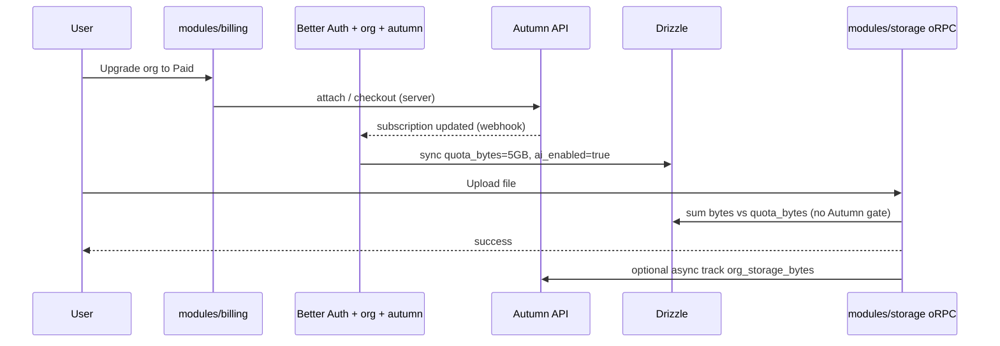

# Requirements: Autumn usage metering (Better Auth plugin)

**Status:** **Approved** (2026-11-14) · **Self-host amendment approved** (2026-11-14) — Autumn **OSS** (not cloud SaaS); hosting/ops + env vars; commercial model unchanged  
**Approved by:** User (chat sign-off 2026-11-14; hosting path decision 2026-11-14 chat)  
**Date:** 2026-11-14

> **Amendment note (2026-11-14):** Billing integration targets a **self-hosted Autumn OSS** instance (team-operated). The Better Auth `autumn()` / `autumn-js` plugin model (`check`, `track`, org-scoped customers) is unchanged; API calls use the self-hosted base URL. **No paid Autumn cloud SaaS** is required. Stripe remains the payment processor **through self-hosted Autumn** (dashboard on that instance). **Local dev infra** (clone upstream + optional Postgres on host `4003`) lives under [infra/autumn/](../../../infra/autumn/README.md); production k8s / managed Autumn deploy remains out of scope.
> **Layers:** packages / features / modules / apps  
**Related:**

| Doc                                                                                      | Relationship                                                                                             |
| ---------------------------------------------------------------------------------------- | -------------------------------------------------------------------------------------------------------- |
| [better-auth.md](./better-auth.md)                                                       | **Prerequisite** — Better Auth `organization` plugin + active org before `customerScope: "organization"` |
| [storage-system.md](./storage-system.md)                                                 | **Approved** — plan-derived quotas (2 GB / 5 GB + credits); amendment **Applied (2026-11-14)**           |
| [auth-account.md](./auth-account.md)                                                     | Account chrome; custom billing UI in `@modules/billing`                                                  |
| [entitlements-design-answers.md](./entitlements-design-answers.md#autumn-usage-metering) | Webhook idempotency, reconcile, downgrade/over-quota, customer bind recovery                             |

## What is Autumn (context)

**Autumn** ([useautumn.com](https://www.useautumn.com) · [Better Auth plugin docs](https://www.better-auth.com/docs/plugins/autumn)) is **open-source** billing infrastructure for SaaS pricing. This product integrates against a **self-hosted Autumn OSS** deployment (not the vendor’s hosted SaaS). It sits **between the application and Stripe**: subscription state, **usage metering**, feature entitlements, credits, invoices, and checkout. The **`autumn-js`** SDK exposes a **Better Auth plugin** (`autumn-js/better-auth`) so authenticated sessions (and optionally **active organizations**) map to Autumn **customers** without bespoke customer-id wiring.

**Payment path:** Stripe is the payment processor **via self-hosted Autumn** — the app does **not** treat raw Stripe webhooks as the primary billing integration. The **self-hosted** Autumn API and its admin dashboard own subscription and usage semantics.

**Repo status (2026-11-14):** `autumn-js` is wired in `@packages/better-auth` (`buildAutumnPlugin()` with `customerScope: "organization"`, `baseURL` from env). **`AUTUMN_API_BASE_URL`** defaults to `http://localhost:4002` in `@packages/t3-env`; **`AUTUMN_SECRET_KEY`** remains optional until billing slice hardens. Local self-host runbook: [infra/autumn/README.md](../../../infra/autumn/README.md).

### Capabilities relevant to this product

| Capability         | Autumn / plugin surface                                                                              |
| ------------------ | ---------------------------------------------------------------------------------------------------- |
| Customer identity  | Auto-create on sign-up; scope: `user`, `organization`, `user_and_organization`, or custom `identify` |
| Entitlements       | `auth.api.check` / client `allowed({ featureId })` — tier, AI flags, included grants                 |
| Usage & credits    | `auth.api.track` with `featureId` + `value`; consumable credits for AI and monthly storage bumps     |
| Invoicing          | Autumn + Stripe — invoice line items; optional async byte mirror for storage meters                  |
| Plans & billing UI | Server APIs (`attach`, portal, customer); client hooks via `AutumnProvider` for session binding only |
| Config             | Plans/features in **self-hosted Autumn dashboard**; `AUTUMN_SECRET_KEY` + API base URL in env        |

## Goal

Wire **Autumn** as the **platform billing layer** for Auth and related product surfaces:

1. **User subscriptions** and **organization-scoped** billing customers (active org).
2. **Org storage** quotas that are **plan-derived** (not a single global hard cap) while **real-time upload gates** stay fast and local.
3. **AI usage** metering and **credit** purchases (extras for AI and monthly storage increases).
4. **Invoices** and subscription state via Autumn/Stripe — not a bespoke Stripe webhook stack in-app.
5. **Custom billing UI** in `@modules/billing` driven by Autumn server APIs — not default `AttachDialog` as the primary UX.

## In scope (after approval)

- [ ] Add `autumn-js` and Better Auth **`autumn()`** + **`autumnClient()`** in `@packages/better-auth` (server + client).
- [ ] New **`@packages/billing`** (or extend `@packages/t3-env` + thin billing helpers) — Autumn server client, feature ID constants, webhook handlers, **Autumn → DB** plan-limit sync.
- [ ] **`@modules/billing`** — oRPC + Account screens: plans, usage, credits, invoices, upgrade flows (custom UI).
- [ ] **`AUTUMN_SECRET_KEY`** and **`AUTUMN_API_BASE_URL`** (or equivalent) required in **all** environments including local dev (shared **self-hosted** dev instance) via `@packages/t3-env`.
- [ ] Pass **`baseURL`** (or `autumnURL`) into `autumn({ … })` in `@packages/better-auth` and mirror base URL for any direct `autumn-js` SDK / `@packages/billing` server client (verify client constructor on implementation slice).
- [ ] **`customerScope: "organization"`** once Better Auth org plugin + active org exist.
- [ ] Autumn **feature IDs** and plans in dashboard (constants in repo); slice-1 IDs in [Features to meter](#features-to-meter-slice-1-proposed).
- [ ] **DB enforce + Autumn entitlements** — see [Source of truth](#source-of-truth-db-enforce--autumn-entitlements).
- [ ] **`AutumnProvider`** in `apps/auth` layout with `useBetterAuth={true}` for customer/session binding where the plugin requires it; **no** scattered per-app providers except auth mounts provider per [Q8](#decisions-user-input-2026-11-14).
- [ ] Optional: async **`track`** of `org_storage_bytes` to Autumn for invoice line items (not upload-path SoT).

## Out of scope (default)

- Raw Stripe as primary app integration (webhooks/checkout logic duplicated outside Autumn).
- Autumn as the only application database (Drizzle remains app SoT for inventory and quota enforcement).
- **Default AttachDialog** as primary billing UX (allowed only as optional dev shortcut unless product changes).
- **Storage v1** folder UI, trash, grants — remain [storage-system.md](./storage-system.md) until org slice ships; billing does not replace that implementation doc.
- Metering **personal** profile avatars ([profile-avatar-blob.md](./profile-avatar-blob.md)).
- Nightly **DB → Autumn** byte mirror as **primary** reconciliation (optional async track only).

## Decisions (user input 2026-11-14)

| #                             | Topic                                                                                                                                                                                                                                                                                                                  | Decision |
| ----------------------------- | ---------------------------------------------------------------------------------------------------------------------------------------------------------------------------------------------------------------------------------------------------------------------------------------------------------------------- | -------- |
| **Q1 — Billing scope**        | **Full platform billing via Autumn** — user subscriptions, org storage, AI billing, invoices; Stripe payments through Autumn (not raw Stripe webhooks as primary).                                                                                                                                                     |
| **Q2 — Quota authority**      | **DB enforce + Autumn entitlements** (refined hybrid) — see [Source of truth](#source-of-truth-db-enforce--autumn-entitlements).                                                                                                                                                                                       |
| **Q3 — Slice-1 features**     | **Proposed** dashboard IDs: `org_storage_bytes`, `ai_usage_credits`, `organization_count` (or seat feature if free org creation is limited). User may amend IDs at dashboard setup.                                                                                                                                    |
| **Q4 — Billing UI**           | **Custom billing UI** wired to Autumn server APIs + own shell / `@modules/billing` screens — **not** relying on default `AttachDialog` as primary UX. `AutumnProvider` still per Better Auth plugin for session/customer binding.                                                                                      |
| **Q5 — Dev env**              | **D)** Require **`AUTUMN_SECRET_KEY` even in dev** — team uses a **shared self-hosted Autumn OSS** dev instance (not Autumn cloud SaaS). Same API surface; keys from that instance’s dashboard.                                                                                                                        |
| **Q9 — Hosting (2026-11-14)** | **Self-host Autumn OSS** — application API points at team-operated instance; **no** dependency on Autumn cloud SaaS subscription.                                                                                                                                                                                      |
| **Q6 — Reconcile**            | **DB primary** for quota display and upload enforcement; **Autumn** for subscription tier, entitlements, credits, AI flags, invoicing. **Periodic sync Autumn → DB** for plan limits on webhook/subscription events (cache), not per-upload Autumn round-trip. Optional async byte **`track`** for invoice line items. |
| **Q7 — Plans**                | **Free:** user can create org(s); **2 GB** org storage. **Paid:** AI features enabled; **5 GB** org storage. **Credits:** purchasable extras for AI usage and **monthly** storage increase (consumable credits).                                                                                                       |
| **Q8 — Cross-app**            | **Layer map per repo conventions** — `@packages/better-auth` plugins; new `@packages/billing` (or env extension); `@modules/billing` (UI + oRPC); `@features` if small; `apps/auth` thin routes; **not** scattered `AutumnProvider` — auth app mounts provider.                                                        |

### Q2 rationale (why not pure Autumn SoT for upload gates)

**Pure Autumn as source of truth** for every upload means a network round-trip to Autumn (or stale cache risk) on **every** `initUpload` / quota check. That hurts **latency**, complicates **offline local dev** (even with a test key, outages or rate limits block storage), and duplicates logic already required in Drizzle for Storage UI totals and org inventory.

**DB enforce + Autumn entitlements** keeps **Drizzle** authoritative for **real-time gates** and **Storage overview** byte sums (fast, same transaction as metadata writes). **Autumn** stays authoritative for **what plan the org is on**, **included bytes**, **AI entitlements**, **credit balances**, and **invoicing**. On subscription create/update/cancel (Autumn webhooks or plugin events), a server handler **writes plan limits into DB** (e.g. `org_storage_quota_bytes`, `ai_enabled`) so oRPC compares `sum(byte_size)` against the **cached limit** without calling Autumn per upload. Entitlement changes (upgrade, credit purchase) refresh that cache. Optional **`track`** to Autumn can run **after** successful upload for billing meters without blocking the gate.

This is stricter than “Autumn mirror only” and more operable than “Autumn blocks every byte” for v1.

## Product plans (approved v1)

| Plan / SKU  | Org storage (included)                        | AI features                       | Org creation           | Notes                                                                      |
| ----------- | --------------------------------------------- | --------------------------------- | ---------------------- | -------------------------------------------------------------------------- |
| **Free**    | **2 GB** per organization                     | Off (or gated by entitlement)     | User can create org(s) | Limit synced to DB on assign/change                                        |
| **Paid**    | **5 GB** per organization                     | **Enabled**                       | Per product policy     | Subscription via custom billing UI                                         |
| **Credits** | **Monthly** consumable storage bump (metered) | **AI usage** credits (consumable) | N/A                    | Purchased extras; Autumn credit balance; gates via entitlements + DB cache |

Exact Stripe prices, credit pack sizes, and Autumn plan IDs are configured in the **self-hosted Autumn dashboard** at implementation slice 1; storage included amounts above are **approved product defaults**.

## Source of truth: DB enforce + Autumn entitlements

| Concern                              | Authoritative system                                  | Mechanism                                                                        |
| ------------------------------------ | ----------------------------------------------------- | -------------------------------------------------------------------------------- |
| Upload allowed / hard gate           | **Drizzle** (sum `byte_size` vs cached `quota_bytes`) | oRPC on `initUpload` / complete — **no** per-request Autumn `check` as SoT       |
| Storage UI “used / limit”            | **Drizzle**                                           | Same sums + cached limit from plan                                               |
| Subscription tier, renewals, payment | **Autumn** (+ Stripe)                                 | Webhooks / server APIs                                                           |
| AI feature on/off, credit balance    | **Autumn**                                            | Entitlements + credits; mirrored to DB flags/limits where needed for fast checks |
| Included storage per plan            | **Autumn** plan definition                            | **Sync → DB** on subscription events                                             |
| Invoice line items (usage)           | **Autumn**                                            | Optional **async** `track` for `org_storage_bytes` / `ai_usage_credits`          |

**Aligned with [storage-system.md](./storage-system.md):** org storage limits are **plan-derived** (2 GB Free / 5 GB Paid + credit bumps), enforced in Drizzle from a plan cache synced from Autumn.

## Storage spec amendment

**Status:** **Applied (2026-11-14)** — joint sign-off with this doc and [storage-system.md](./storage-system.md).

| Item                  | Pre-amendment (2026-11-14 initial) | Authoritative after amendment                                                                       |
| --------------------- | ---------------------------------- | --------------------------------------------------------------------------------------------------- |
| Org storage cap       | **5 GB** for every org             | **Plan-derived:** **2 GB** (Free), **5 GB** (Paid), plus **credit-based** monthly storage increases |
| Quota enforcement SoT | App DB hard cap                    | Unchanged — **DB enforces**; limit value **from plan cache** synced from Autumn                     |
| Billing               | Out of scope                       | In scope per this doc                                                                               |

**Implementation:** Upload gate / `getUsage` read **cached `quota_bytes`** (not a single global constant once billing sync ships). **Interim:** org storage slice may use a **5 GB constant** until the **Autumn → DB plan-limit sync** slice lands; production plan sync must not ship without quota copy aligned to this table.

See [storage-system.md — Quotas and limits](./storage-system.md#quotas-and-limits-decided--tbd).

## Architecture (layer map — proposed)

| Decision                                     | Proposed owner            | Notes                                                                                |
| -------------------------------------------- | ------------------------- | ------------------------------------------------------------------------------------ |
| Better Auth: `organization()` + `autumn()`   | `@packages/better-auth`   | Plugin order: org before autumn; `customerScope: "organization"`                     |
| Autumn server + webhooks + feature constants | `@packages/billing` (new) | Secret key, plan-limit sync to Drizzle, webhook routes                               |
| Env validation                               | `@packages/t3-env`        | `AUTUMN_SECRET_KEY` + `AUTUMN_API_BASE_URL` **required** in dev and prod             |
| Billing UI + oRPC                            | `@modules/billing` (new)  | Plans, usage, credits, invoices — custom screens                                     |
| Storage upload gate                          | `@modules/storage`        | DB quota vs cached limit; optional post-upload `track`                               |
| AI meters                                    | TBD module(s)             | `ai_usage_credits` track/check per product routes                                    |
| Small shared UI pieces                       | `@features`               | Only if truly minimal                                                                |
| Routes / provider                            | `apps/auth`               | Thin routes; **single** `AutumnProvider` mount                                       |
| Other apps                                   | Satellite apps            | Call shared billing helpers or Auth — **no** duplicate provider unless later amended |

## Integration with Better Auth organization plugin

1. Ship **Better Auth `organization` plugin** + **active org** in session ([better-auth.md](./better-auth.md), [storage-system.md](./storage-system.md) R1).
2. Configure **`autumn({ customerScope: "organization" })`** so each **active organization** maps to an Autumn customer (auto-create on first billing interaction or sign-up policy TBD in slice 1).
3. **Org owner / billing role** (exact role TBD with org plugin) can open `@modules/billing` for that org’s subscription and credits.
4. **Free tier:** org creation allowed; new org gets Free plan entitlements → DB cache **2 GB**.
5. **Upgrade:** custom UI calls Autumn server APIs → webhook updates subscription → handler sets DB **5 GB** + `ai_enabled`.

## Features to meter (slice-1 proposed)

| Feature ID (proposed) | Unit    | When to track / entitle                                         | Notes                                                            |
| --------------------- | ------- | --------------------------------------------------------------- | ---------------------------------------------------------------- |
| `org_storage_bytes`   | bytes   | Optional async after upload/delete; entitlement grant from plan | Align with credits model for monthly storage bump                |
| `ai_usage_credits`    | credits | On AI operations (routes TBD)                                   | Paid + credit packs                                              |
| `organization_count`  | count   | On org create                                                   | Limit free org creation if product requires; or use seat feature |

Amend IDs in dashboard and repo constants when configuring Autumn.

## Hosting and operations (self-hosted Autumn OSS)

| Topic                | Decision / note                                                                                                                                                                                  |
| -------------------- | ------------------------------------------------------------------------------------------------------------------------------------------------------------------------------------------------ |
| **Deployment model** | Team runs **Autumn OSS** (containers/VM — ops slice **out of scope** for app repo). App env points API clients at that deployment.                                                               |
| **Dashboard**        | Plan/feature/Stripe wiring on the **self-hosted** admin UI; secret keys issued there (`am_sk_…` or instance-specific format — verify on install).                                                |
| **Environments**     | **Local/preview:** shared dev instance URL + dev keys. **Production:** dedicated prod instance URL + prod keys.                                                                                  |
| **Webhooks**         | Autumn → app webhook URL must reach `apps/auth` (or chosen route); signing secret from **self-hosted** instance config.                                                                          |
| **Stripe**           | Connected in Autumn admin on the self-hosted instance — **not** duplicated as primary app Stripe integration.                                                                                    |
| **Availability**     | Upload/AI hot paths use **DB cache** when Autumn is down ([Q2](#q2-rationale-why-not-pure-autumn-sot-for-upload-gates)); purchase/upgrade needs live Autumn API.                                 |
| **Repo scope**       | [infra/autumn/](../../../infra/autumn/README.md) — clone `useautumn/autumn`, optional Postgres compose, env wiring in `@packages/t3-env` + `buildAutumnPlugin()`. No production k8s / Terraform. |

### `autumn-js` custom API URL (implementation verify)

**Pinned repo version (`autumn-js@1.5.11`):** Better Auth `autumn()` accepts **`baseURL`** and alias **`autumnURL`** on `AutumnOptions` (types in `autumn-js/dist/better-auth/types.d.ts`). **`@packages/better-auth`** must pass through env-based base URL when implementing.

| Open impl detail                  | Action                                                                                                    |
| --------------------------------- | --------------------------------------------------------------------------------------------------------- |
| Direct SDK in `@packages/billing` | Confirm server `Autumn` / HTTP client `baseURL` option matches plugin (same env var).                     |
| `AutumnProvider` / client plugin  | Confirm client-side calls use app proxy or same base URL policy (Better Auth endpoints vs direct Autumn). |
| Webhook URL on self-host          | Register public URL per environment in self-hosted dashboard.                                             |

## Environment

| Variable                      | Required                             | Purpose                                                                                                                                                                 |
| ----------------------------- | ------------------------------------ | ----------------------------------------------------------------------------------------------------------------------------------------------------------------------- |
| `AUTUMN_SECRET_KEY`           | **Yes — including local dev**        | From **self-hosted** Autumn dashboard; server plugin + `@packages/billing`                                                                                              |
| `AUTUMN_API_BASE_URL`         | **Yes — including local dev**        | Origin of self-hosted Autumn API (e.g. `https://autumn.dev.internal` — **no** trailing path unless instance requires). Passed to `autumn({ baseURL })` and billing SDK. |
| Stripe                        | Via **self-hosted** Autumn dashboard | Not primary in app env                                                                                                                                                  |
| `BETTER_AUTH_*` / org session | Existing                             | Active org for org-scoped customers                                                                                                                                     |

All new vars **MUST** go through `@packages/t3-env`.

**Code (2026-11-14):** `buildAutumnPlugin()` passes `baseURL: serverEnv.AUTUMN_API_BASE_URL` (default `http://localhost:4002`). **Follow-up:** wire `@packages/billing` Autumn client to the same base URL when that package lands.

## Plugins / integrations

| Capability            | v1 proposal                     | Package / plugin                              |
| --------------------- | ------------------------------- | --------------------------------------------- |
| Better Auth org       | **Required**                    | `better-auth/plugins/organization`            |
| Autumn                | **Yes** (after approval)        | `autumn-js/better-auth`, client plugin        |
| Stripe                | **Via self-hosted Autumn only** | Self-hosted dashboard                         |
| Vercel Blob / storage | Unchanged                       | `@packages/blob`; gates in `@modules/storage` |

## Dev / prod

| Environment    | Behavior                                                                                                                                               |
| -------------- | ------------------------------------------------------------------------------------------------------------------------------------------------------ |
| **Local dev**  | **Shared self-hosted Autumn OSS** dev instance; **`AUTUMN_SECRET_KEY`** + **`AUTUMN_API_BASE_URL` required** — fail fast if missing                    |
| **Preview**    | Preview base URL + keys on same or sibling self-hosted instance; isolate customers per [entitlements-design-answers](./entitlements-design-answers.md) |
| **Production** | Production self-hosted Autumn + Stripe; org customers require active org                                                                               |

## End-to-end flow (target — org storage + billing)

1. User with **active org** on **Free** plan: DB shows **2 GB** limit (synced from Autumn).
2. Upload: oRPC enforces DB sum vs **cached** limit; optional Autumn `track` after commit.
3. User opens **Account → Billing** (`@modules/billing`): usage, plan, buy credits — custom UI, Autumn APIs.
4. **Paid** upgrade: subscription event → DB **5 GB** + AI entitlements.
5. **AI** action: check entitlements/credits (Autumn or cached mirror per slice design); `track` `ai_usage_credits`.

## Sequencing and blockers

| Dependency                                          | Blocks billing slice?            | Blocks storage v1?                    |
| --------------------------------------------------- | -------------------------------- | ------------------------------------- |
| Better Auth **org** plugin                          | **Yes**                          | **Yes** (storage already gated)       |
| This doc + **plan numbers** + storage **amendment** | **Yes** (approved)               | Interim 5 GB constant until plan sync |
| Self-hosted Autumn dashboard plans/features         | **Yes** for paid/credits         | **No** for DB-only 5 GB storage MVP   |
| Self-hosted Autumn instance reachable from app      | **Yes** for check/track/webhooks | **No** for DB-only interim quota      |

Storage may ship with a **5 GB interim constant** until **Autumn → DB** plan-limit sync; billing production sync requires aligned quota copy and cached limits per [storage-system.md](./storage-system.md).

## Gaps / open questions (reduced)

- [x] **Org billing role** — **owner only** (2026-11-14) — [org-roles-rbac.md](./org-roles-rbac.md)
- [ ] **Credit semantics** — exact monthly storage credit burn vs cumulative cap extension.
- [ ] **Autumn customer lifecycle** on org delete ([storage-system.md](./storage-system.md) R8 deferred).
- [ ] **AI routes** first slice — which module owns `ai_usage_credits`? (**AI spend routing** via Vercel AI Gateway is a **separate later slice** — internal org tags, not customer billing; see [entitlements-design-answers](./entitlements-design-answers.md#addendum-2026-11-14-self-host--ai-gateway).)
- [ ] **Self-host ops** — who owns Autumn OSS deploy, upgrades, backups (out of app repo).
- [ ] **Webhook handler** location — `@packages/billing` route in `apps/auth` only?
- [ ] **i18n** for billing and limit copy on Storage + Billing tabs.
- [ ] Confirm Autumn is the chosen path vs better-auth v2 generic “billing” stub.

## Additional findings to resolve before implementation

- **Proposed approach:** Signed webhook processing, idempotent customer binding, an event journal, periodic reconciliation, isolated test identifiers, and billing drift alerts are described in the [design answers](./entitlements-design-answers.md#autumn-usage-metering). Provider APIs and a consistent cache-freshness policy must be verified before adoption.

These findings identify implementation gaps and do not amend approved commercial decisions.

- **Webhook integrity and ordering:** Specify signature verification, event deduplication, replay protection, ordering, retries, and handling of unknown customers or events.
- **Reconciliation:** Define a scheduled Autumn-to-DB repair process, freshness thresholds, discrepancy alerts, and outage behavior for plan and credit caches.
- **Customer provisioning:** Make organization-to-customer binding idempotent and recoverable when remote creation succeeds but local persistence fails.
- **Subscription lifecycle:** Define entitlement timing and behavior for checkout abandonment, payment failure, cancellation, renewal, refunds, chargebacks, and delayed events.
- **Over-quota transitions:** Define read, upload, restore, and deletion behavior when a downgrade or expired storage credit leaves usage above the new limit.
- **Usage semantics:** Define whether storage tracking represents a current balance or deltas, including retries, deletion, restore, and reconciliation; avoid duplicate invoice usage.
- **Environment isolation:** Establish customer identifiers and guardrails for the shared test project so local and preview deployments cannot affect production or each other's data.
- **Dashboard drift:** Validate plan definitions, feature identifiers, units, and pricing configuration against application expectations before rollout.
- **Ownership boundaries:** Clarify the user subscription model and per-user organization creation entitlement alongside organization-scoped billing customers.
- **Operations:** Monitor failed binding, webhook delivery, stale entitlements, and reconciliation failures; define owner-facing pending and error states.

## Implementation slices (after approval)

1. **Self-hosted Autumn dashboard** — Plans (Free/Paid), credits, feature IDs; record in repo; register webhook URLs per env.
2. **Env + `@packages/billing`** — `autumn-js`, required secret + **`AUTUMN_API_BASE_URL`**, webhook + **Autumn → DB** sync.
3. **Better Auth** — `organization()` + `autumn({ secretKey, baseURL })` + `autumnClient()`; auth app `AutumnProvider`.
4. **`@modules/billing`** — Custom UI + oRPC (no AttachDialog-primary).
5. **Drizzle** — `org_storage_quota_bytes`, `ai_enabled` (or equivalent) on org/billing table.
6. **Storage** — Upload gate reads cached quota; optional async `track`.
7. **Storage quota** — Cached `quota_bytes` per [storage-system.md](./storage-system.md) (amendment applied 2026-11-14).

## Validation checklist (before sign-off)

- [x] Q1–Q8 answered under **Decisions**
- [x] Plan numbers (2 GB / 5 GB / credits) explicitly approved (2026-11-14 chat)
- [x] Storage quota amendment **Applied (2026-11-14)** — [storage-system.md](./storage-system.md)
- [x] Feature IDs documented (slice-1 proposed); dashboard IDs recorded at implementation slice 1
- [x] `AUTUMN_SECRET_KEY` required in dev documented in **Environment**
- [x] Self-host amendment: `AUTUMN_API_BASE_URL` + hosting section (2026-11-14) — **approved** (2026-11-14)
- [x] Source-of-truth model **DB enforce + Autumn entitlements** explicit
- [x] Custom billing UI scope (Q4) explicit
- [x] No unnamed Stripe price IDs in doc (Stripe via Autumn dashboard only)
- [x] User confirmed sign-off (2026-11-14 chat)

## Amendment sign-off (2026-11-14 — self-host)

| Amendment item                                  | Status                                                                                              |
| ----------------------------------------------- | --------------------------------------------------------------------------------------------------- |
| Self-hosted Autumn OSS (not cloud SaaS)         | **Recorded** — user decision 2026-11-14 chat                                                        |
| Env: `AUTUMN_API_BASE_URL` + self-hosted secret | **Implemented** — default API `http://localhost:4002`; secret optional until billing hardening      |
| `autumn()` `baseURL` / `autumnURL`              | **Wired** in `@packages/better-auth` (`autumn-js@1.5.11`)                                           |
| Self-host infra in repo                         | **Approved** — local dev [infra/autumn/](../../../infra/autumn/README.md); prod deploy out of scope |

- [x] User: **re-approved** amended doc (2026-11-14 — self-host wording + env/infra slice)

Prior **Q1–Q8** commercial and architecture decisions remain approved unless this amendment explicitly overrides them (hosting path only).

## Approval

**Sign-off summary:**

| Item                                                                                        | Status                                                             |
| ------------------------------------------------------------------------------------------- | ------------------------------------------------------------------ |
| **Q1–Q8** decisions (full platform billing, DB enforce + Autumn, custom UI, dev key)        | **Approved**                                                       |
| **Plan table** — Free **2 GB** + orgs; Paid **5 GB** + AI; credits for AI + monthly storage | **Approved**                                                       |
| **Storage quota amendment** — plan-derived limits                                           | **Approved** — applied in [storage-system.md](./storage-system.md) |

**Sign-off record:**

- [x] User: **APPROVED** (2026-11-14 chat)
- **Approved by:** User (chat sign-off 2026-11-14)
- **Date:** 2026-11-14

**Workflow:** [../../workflow/04-requirements-first.md](../../workflow/04-requirements-first.md)
