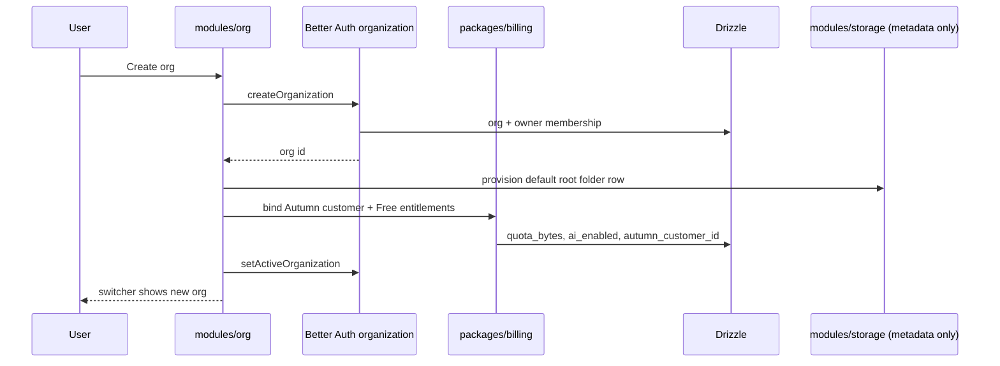

# Requirements: Organizations (Better Auth organization plugin)

**Status:** Approved  
**Approved by:** User batch sign-off — **2026-11-14**  
**Date:** 2026-11-14  
**Layers:** packages / features / modules / apps  
**Related:**

| Doc                                                                              | Relationship                                                                                                                  |
| -------------------------------------------------------------------------------- | ----------------------------------------------------------------------------------------------------------------------------- |
| [better-auth.md](./better-auth.md)                                               | **Prerequisite identity** — org slice was deferred from BA v1; this doc scopes the org product slice                          |
| [storage-system.md](./storage-system.md)                                         | **Approved** — org-scoped storage; default org root; avatar path; **R1:** org before storage                                  |
| [autumn-usage-metering.md](./autumn-usage-metering.md)                           | **Approved** — `customerScope: "organization"`; `organization_count`; Free **2 GB** per org on create                         |
| [org-roles-rbac.md](./org-roles-rbac.md)                                         | **Approved** — owner / manager / member enforcement                                                                           |
| [platform-entitlements-plan.md](../platform-entitlements-plan.md)                | Master map — phases and dependencies                                                                                          |
| [account-data-retention-deletion.md](./account-data-retention-deletion.md)       | **Draft** — user delete vs org membership; dissolution cross-cut                                                              |
| [entitlements-design-answers.md](./entitlements-design-answers.md#organizations) | `organization_count` semantics, create recovery, invites, active-org switching                                                |
| [organization-onboarding-wizard.md](./organization-onboarding-wizard.md)         | **Draft** — 8-step create/edit wizard, review screen, sectioned DB mapping; supersedes minimal 4-step create UX when approved |

## Goal

Give every signed-in user a **first-class organization tenancy** on the auth domain: create organizations, invite and accept members, leave or be removed, and always operate product features (Storage, Billing, future AI) against an **active organization** in session — backed by the Better Auth **organization** plugin, without trusting client-supplied org IDs.

## In scope (after approval)

- [ ] Better Auth **`organization()`** server plugin + **`organizationClient()`** in `@packages/better-auth` (schema via BA generator in `@packages/drizzle`).
- [ ] **Org CRUD (v1):** create, rename, slug (rules TBD), optional logo path via org storage ([storage-system.md](./storage-system.md) `loftlancer/orgs/{orgId}/avatar/`).
- [ ] **Membership:** list members; roles assigned per [org-roles-rbac.md](./org-roles-rbac.md) (owner, manager, member).
- [ ] **Invitations:** **owner only** sends invite ([org-roles-rbac.md](./org-roles-rbac.md)); **email** transport (Resend when available); accept/decline; default role **member** on join.
- [ ] **Leave org** (owner blocked until transfer — see open deferrals) and **remove member** (**owner only** in v1).
- [ ] **Active organization** on session (cookie or BA session field); **switcher** in `@modules/shell` or new `@modules/org`.
- [ ] **Empty / no-org states** for Account Storage and Billing — org picker or CTA to create/join ([platform-entitlements-plan.md](../platform-entitlements-plan.md) §4.2).
- [ ] **Default org storage root** — metadata provisioned on org create (logical root folder row; no blob upload required) per [storage-system.md](./storage-system.md).
- [ ] **Entitlement bootstrap on create:** DB cache **Free** plan defaults — **`quota_bytes` = 2 GB**, **`ai_enabled` = false** — and **Autumn customer binding** for the org (`customerScope: "organization"`) in the same binding slice or immediately after create ([autumn-usage-metering.md](./autumn-usage-metering.md)).
- [ ] **Org creation limits on Free** — enforce via Autumn feature **`organization_count`** (or equivalent dashboard ID) mirrored to DB where needed; Free cap **1 org per user** (signed off 2026-11-14).
- [ ] **Transfer ownership** — product policy stub (minimum: only owner can transfer; target must be member).
- [ ] oRPC / API: all org-scoped handlers derive `organization_id` from session + membership, never from unverified client body alone ([org-roles-rbac.md](./org-roles-rbac.md)).

## Out of scope (default)

- **Org dissolution / delete organization** — **deferred** ([storage-system.md](./storage-system.md) R8; [account-data-retention-deletion.md](./account-data-retention-deletion.md)); note lifecycle hooks only.
- Teams, sub-orgs, SCIM, org-owned API keys ([better-auth.md](./better-auth.md) out of scope).
- Studio/Console-specific org admin (Account hub first).
- Billing UI implementation ([autumn-usage-metering.md](./autumn-usage-metering.md)); only **customer id binding** on create in org slice.
- Storage upload, grants, trash — [storage-system.md](./storage-system.md) after org ships.

## Decisions (user input 2026-11-14)

| #                          | Topic                                                                                                                                                    | Decision |
| -------------------------- | -------------------------------------------------------------------------------------------------------------------------------------------------------- | -------- |
| **O1 — Plugin**            | Better Auth **`organization()`** + **`organizationClient()`**; plugin order before **`autumn()`** when billing slice lands                               |
| **O2 — Tenancy**           | Organization is the boundary for storage, billing customer, and AI gates ([platform-entitlements-plan.md](../platform-entitlements-plan.md))             |
| **O3 — Active org**        | Session carries **active organization**; switcher UX; org-scoped routes require active org + membership                                                  |
| **O4 — Storage root**      | On org create, provision **one default org storage root** (metadata only) per [storage-system.md](./storage-system.md) R3                                |
| **O5 — Free entitlements** | New org starts on **Free**: **2 GB** cached quota, **AI off** ([autumn-usage-metering.md](./autumn-usage-metering.md) plan table)                        |
| **O6 — Autumn binding**    | **One Autumn customer per org** — create/bind on org create (binding slice), not only on first manual billing visit                                      |
| **O7 — Org creation cap**  | Free tier: **`organization_count` = 1** per user — Autumn feature + pre-create enforcement ([autumn-usage-metering.md](./autumn-usage-metering.md) Q3)   |
| **O8 — Dissolution**       | **Deferred** — document hook points only; no delete-org UX in v1                                                                                         |
| **O9 — Invitations**       | **Email** invitations (Resend when available); **owner only** may invite (manager has no invite/remove in v1 — [org-roles-rbac.md](./org-roles-rbac.md)) |
| **O10 — Cross-org**        | Cross-org resource access → **403 Forbidden** (normative with [org-roles-rbac.md](./org-roles-rbac.md) R5)                                               |

### Cross-spec defaults (pre-filled from approved docs)

| Item                        | Value                                    | Source           |
| --------------------------- | ---------------------------------------- | ---------------- |
| Org storage included (Free) | **2 GB** `quota_bytes` cache             | autumn + storage |
| Org storage included (Paid) | **5 GB** (after upgrade — billing slice) | autumn + storage |
| Blob prefix                 | `loftlancer/orgs/{orgId}/…`              | storage R7       |
| Customer scope              | `organization`                           | autumn           |

## Architecture (layer map)

| Decision                                            | Proposed owner                            | Notes                                                                      |
| --------------------------------------------------- | ----------------------------------------- | -------------------------------------------------------------------------- |
| BA org plugins + session helpers                    | `@packages/better-auth`                   | Server config, client methods, org tables                                  |
| Schema / migrations                                 | `@packages/drizzle`                       | BA org generator output + app extensions (entitlement cache FK)            |
| Org product UI (create, settings, members, invites) | `@modules/org` (new)                      | FormKit for forms per workspace rules                                      |
| Switcher + empty states                             | `@modules/shell`                          | Account chrome; links to org module screens                                |
| Entitlement bootstrap + Autumn customer             | `@packages/billing` (new)                 | Called from org-create hook; writes DB cache + stores `autumn_customer_id` |
| oRPC org context middleware                         | `@modules/security` or shared org package | Shared with storage/billing ([org-roles-rbac.md](./org-roles-rbac.md))     |
| Routes                                              | `apps/auth`                               | Thin pages under `/account/…` or `/org/…` as shell defines                 |

## End-to-end flows

### Create organization

1. Signed-in user opens **Create organization** (Account or switcher empty state).
2. Server checks **`organization_count`** entitlement (Autumn/check or DB mirror) for creating user on Free tier.
3. Better Auth creates org + membership with role **owner** (see RBAC doc for BA role mapping).
4. App provisions **default storage root** metadata row for `organization_id`.
5. App creates/links **Autumn customer** for org; writes entitlement cache: `plan_tier=free`, `quota_bytes=2GB`, `ai_enabled=false`, `autumn_customer_id`, `entitlements_synced_at`.
6. Session **active organization** set to new org; user lands on org home or Storage overview empty state.

### Invite and join

1. **Owner** sends **email** invitation (Resend when available) with intended role (default **member**).
2. Invitee receives link; signs in if needed; accepts → membership row + role.
3. Activity event (org-scoped) — action IDs TBD with [application-activity.md](./application-activity.md).

### Switch active org

1. User opens switcher; picks org they belong to.
2. Server updates session active org; client invalidates org-scoped React Query caches (storage, billing).

### Leave / remove member

1. **Member** may leave (owner cannot leave without transfer — **TBD**).
2. **Owner** (and manager if permitted) removes member → revoke grants indirectly via membership loss (storage grants cleanup **TBD**).

### No active org / zero orgs

1. User with zero orgs: switcher shows **Create organization** CTA.
2. User with orgs but no active org set: prompt to select org before Storage/Billing tabs show data (**not** silent cross-org access).

## Environment

| Variable            | Required                    | Purpose                                                                         |
| ------------------- | --------------------------- | ------------------------------------------------------------------------------- |
| `BETTER_AUTH_*`     | Yes (existing)              | Session, org plugin                                                             |
| `DATABASE_URL`      | Yes                         | Org tables + entitlement cache                                                  |
| `AUTUMN_SECRET_KEY` | Yes when binding slice runs | Org customer create ([autumn-usage-metering.md](./autumn-usage-metering.md) Q5) |
| Email provider      | Yes for invites             | **Resend** when available; email-only invite transport (2026-11-14)             |

## Plugins / integrations

| Capability               | v1                      | Package / plugin                             |
| ------------------------ | ----------------------- | -------------------------------------------- |
| Better Auth organization | **Yes**                 | `better-auth/plugins/organization`           |
| Better Auth autumn       | After org + binding     | `autumn-js/better-auth`; order: org → autumn |
| Vercel Blob              | Metadata only on create | `@packages/blob` — no upload on create       |

## Roles and authorization

Org membership roles are **owner**, **manager**, **member** — normative matrix in [org-roles-rbac.md](./org-roles-rbac.md). Organization **creation** assigns **owner** to creator. Invitation default role: **member** unless elevated by inviter per RBAC policy.

**Billing:** upgrade plan and buy credits — **org owner only** (2026-11-14 user decision; detailed in RBAC doc).

## Org dissolution (deferred — hook points only)

Not implemented in v1. Requirements for a future slice:

- Block new uploads and AI; read/trash policy for storage ([storage-system.md](./storage-system.md) R8).
- Autumn customer cancel/archive ([autumn-usage-metering.md](./autumn-usage-metering.md) gap).
- Membership and session active-org cleanup.

## Gaps / open questions

### Pre-filled / leaning on approved specs

- [x] **Default quota on create** — **2 GB** Free ([autumn-usage-metering.md](./autumn-usage-metering.md)).
- [x] **AI default on create** — **off** on Free.
- [x] **Storage root** — one default root per org ([storage-system.md](./storage-system.md)).
- [x] **Autumn customer** — per org, organization scope ([autumn-usage-metering.md](./autumn-usage-metering.md)).
- [x] **Dissolution** — deferred ([storage-system.md](./storage-system.md) R8).

### Resolved at sign-off (2026-11-14)

- [x] **Free tier `organization_count` limit** — **1 org per user** on Free; enforce pre-create + Autumn feature mirror.
- [x] **Invitation transport** — **email** (Resend when available); expiry/single-use details at implement.
- [x] **Remove member** — **owner only** in v1; managers cannot invite/remove ([org-roles-rbac.md](./org-roles-rbac.md)).

### Deferred to implementation (not blocking v1 org slice)

- [ ] **Org slug rules** — uniqueness, reserved words, URL exposure — decide in BA create org slice.
- [ ] **Owner leave / last owner** — require transfer or block leave; multiple owners in v1? (BA default vs product)
- [ ] **Rename org** — owner only assumed; impact on slug.
- [ ] **Grants on member remove** — auto-revoke storage grants or orphan until owner cleans ([storage-system.md](./storage-system.md) slice).
- [ ] **Autumn customer create failure** on org create — fail org create vs org exists with retry banner.
- [ ] **Fresh session** for create org / accept invite — required or not.

## Additional findings to resolve before implementation

- **Proposed approach:** Provision organizations through recoverable idempotent steps; bind invitations to verified email; invalidate previous-org client data on switching; and serialize creation-limit checks. See the [design answers](./entitlements-design-answers.md#organizations). The proposed owned-org counting and transfer rules require product sign-off.

- **Creation limit definition:** Specify whether the per-user limit counts created, owned, or joined organizations, how ownership transfer affects it, and which entitlement applies when billing is organization-scoped.
- **Concurrent creation:** Enforce the user-level limit atomically across simultaneous requests and retries.
- **Provisioning recovery:** Make organization creation, root creation, default entitlements, and customer binding idempotent and repairable after partial failure; define when a partially provisioned organization becomes usable.
- **Invitation security:** Define verified-email matching, expiration, single use, revocation, resend, duplicate invitations, delivery failures, and behavior when the recipient signs in as another user.
- **Invitation roles:** Specify which roles an invitation can assign and ensure owner invitations cannot bypass ownership-transfer and last-owner rules.
- **Session transitions:** Define active-org selection after removal, leaving, acceptance, and across multiple sessions or tabs; membership must be revalidated before org-scoped operations.
- **Switching races:** Partition and invalidate client caches by organization and prevent in-flight responses from the previous organization appearing in the newly selected context.
- **Existing users:** Define migration and no-org behavior for existing users and sessions when the organization plugin is enabled.
- **Account deletion:** Preserve the last-owner invariant and define how membership removal interacts with existing organization data and invitations; organization dissolution remains deferred.

## Implementation slices (after approval)

1. **BA organization plugin** — server + client, migrations, typed client in app.
2. **Active org session** + switcher empty states in shell.
3. **`@modules/org`** — create org, list memberships, settings skeleton.
4. **Invitations** — send, accept, decline (**email** / Resend when available; owner only).
5. **Binding slice** — default storage root row + entitlement cache + Autumn customer on create.
6. **`organization_count` gate** — Free tier create limit.
7. **Leave / remove / transfer ownership** — per signed-off policy.

## Validation checklist (before sign-off)

- [x] Every env var listed (incl. Autumn when binding in scope)
- [x] Routes/pages named for create, settings, members, invites, switcher (slices list)
- [x] DB migration path agreed (BA org + entitlement columns)
- [x] `organization_count` limit numerically specified — **1** on Free
- [x] Invitation flow specified — **email** (Resend when available)
- [x] No silent wrong-org access documented — **403** cross-org ([org-roles-rbac.md](./org-roles-rbac.md))
- [x] Cross-links to storage, autumn, platform plan, better-auth
- [x] User confirmed sign-off — **2026-11-14**

## Approval

**Sign-off record:**

- [x] User: **APPROVED** **2026-11-14** (batch: org_count=1, email invites, manager=no invite/remove v1)

**Workflow:** [../../workflow/04-requirements-first.md](../../workflow/04-requirements-first.md)

## Route and navigation amendment (2026-11-14)

- Organization creation and onboarding use `/organizations/create`; the user's memberships and selection use `/organizations/list` (`/organizations` also opens the list).
- `/account/organization` and its members and invitations pages apply to the active organization. When none is selected, open the organization list.
- Place organization management immediately below Account in the Account sidebar. Keep the organization switcher compact and outside an extra sidebar group; offer list and create actions.
- A successful creation selects the organization and opens its Account settings. Switching reloads organization-scoped state before the user continues.
- Invitation acceptance remains dependent on the existing invitation slice; do not invent an acceptance route.
